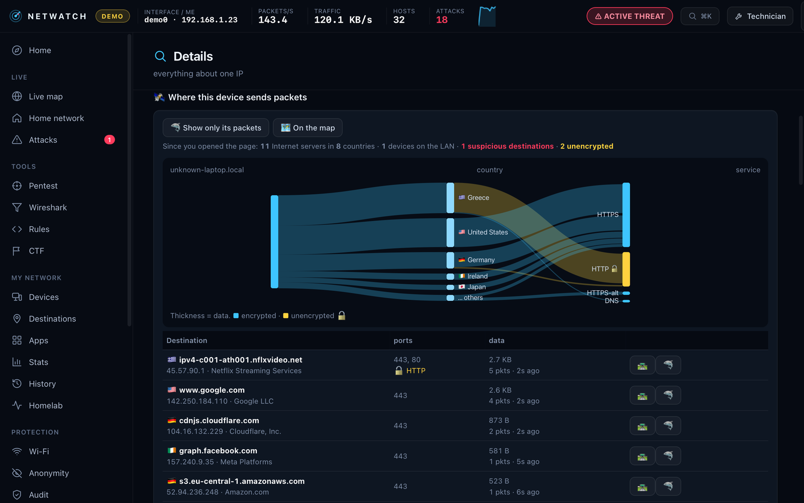
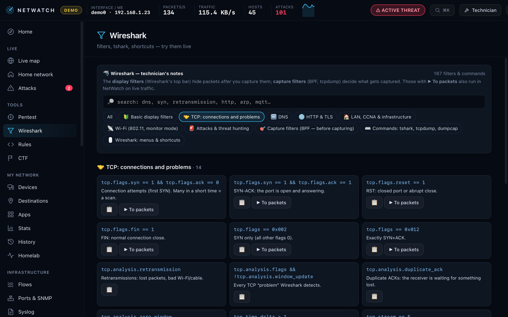

<h1> NetWatch</h1>

Ζωντανός χάρτης της κίνησης του δικτύου σου + ανίχνευση επιθέσεων + OSINT για κάθε IP.

**▶ [Online demo](https://gyuri1999.github.io/netwatch/?lang=el)** (προσομοίωση, τρέχει στον browser) · **📚 [Ακαδημία](https://gyuri1999.github.io/netwatch/academy.html?lang=el)**

**⬇ [Κατέβασε την τελευταία έκδοση](https://github.com/Gyuri1999/netwatch/releases/latest)**: [Windows 10/11 (`NetWatch-windows-x64.zip`)](https://github.com/Gyuri1999/netwatch/releases/latest/download/NetWatch-windows-x64.zip) · [macOS (`NetWatch.dmg`)](https://github.com/Gyuri1999/netwatch/releases/latest/download/NetWatch.dmg)


| | |
|---|---|
|  **Αρχική τεχνικού** |  **Πού στέλνει πακέτα μια συσκευή** |
|  **Διαδρομή βήμα-βήμα** |  **Σημειώσεις Wireshark** |

<sub>Περισσότερες εικόνες στο [README.md](README.md#screenshots). Βγαίνουν από το demo με το [`tools/shots/make_shots.sh`](tools/shots/make_shots.sh).</sub>

## Εκκίνηση

```bash
chmod +x run.sh
./run.sh            # πραγματική καταγραφή (ζητάει τον κωδικό του Mac για sudo)
./run.sh --demo     # προσομοίωση με ψεύτικη κίνηση και επιθέσεις
./run.sh --pcap samples/lan-attack.pcap   # αναπαραγωγή καταγεγραμμένης επίθεσης (χωρίς sudo)
```

**Εφαρμογή για Mac:** κατέβασε το [`NetWatch.dmg`](https://github.com/Gyuri1999/netwatch/releases/latest/download/NetWatch.dmg) από την [τελευταία έκδοση](https://github.com/Gyuri1999/netwatch/releases/latest) και σύρε το NetWatch στις Εφαρμογές. Ή χτίσ' το μόνος σου: `./macapp/build.sh --install` φτιάχνει το **NetWatch.app** στο ~/Applications (με `--dmg` φτιάχνει και `dist/NetWatch.dmg` για να το μοιραστείς). Δεν χρειάζεται Xcode. Στη γραμμή μενού εμφανίζεται μια ασπίδα που γίνεται πράσινη, κίτρινη ή κόκκινη, με τον αριθμό των ειδοποιήσεων. Από το μενού της βλέπεις την τελευταία ειδοποίηση και την ετυμηγορία του Wi‑Fi, τρέχεις έλεγχο Wi‑Fi και αλλάζεις ανάμεσα σε Live, Demo και pcap. Ο πίνακας ανοίγει σε δικό του παράθυρο. Για το Live ζητάει τον κωδικό του Mac στο κανονικό παράθυρο του macOS.

**Εφαρμογή για Windows 10/11 (χωρίς Python):** κατέβασε το [`NetWatch-windows-x64.zip`](https://github.com/Gyuri1999/netwatch/releases/latest/download/NetWatch-windows-x64.zip) από την [τελευταία έκδοση](https://github.com/Gyuri1999/netwatch/releases/latest), αποσυμπίεσέ το και τρέξε το **`NetWatch.exe`**. Στο system tray εμφανίζεται μια ασπίδα (πράσινη, κίτρινη ή κόκκινη, με τον αριθμό των ειδοποιήσεων) και ο πίνακας ανοίγει σε δικό του παράθυρο. Από το μενού της αλλάζεις Live, Live ως διαχειριστής (για μπλοκάρισμα IP), Demo και pcap, και ενεργοποιείς την «Εκκίνηση μαζί με τα Windows». Για Live χρειάζεται το [Npcap](https://npcap.com/#download). Την πρώτη φορά το SmartScreen ρωτά: «Περισσότερες πληροφορίες → Εκτέλεση οπωσδήποτε».

**Windows από τον κώδικα:** εγκατάστησε Python 3.9+ (`winget install Python.Python.3.12`) και, για Live, το **[Npcap](https://npcap.com/#download)** (άφησε τσεκαρισμένο το «WinPcap API-compatible Mode»). Μετά διπλό κλικ στο **`run.bat`**, ή `run.bat --demo`, `run.bat --pcap samples\lan-attack.pcap`. Με `run.bat -Admin` ανοίγει ως διαχειριστής, ώστε να δουλεύει το μπλοκάρισμα IP στο Τείχος προστασίας των Windows. Με `run.bat -Shortcut` μπαίνει συντόμευση στην επιφάνεια εργασίας. Ο πίνακας ανοίγει στον browser. Στο Edge, με «⋯ → Εφαρμογές → Εγκατάσταση αυτής της τοποθεσίας ως εφαρμογής» αποκτά δικό του παράθυρο. Δουλεύει και σε ελληνικά Windows. Δεν υπάρχουν ακόμα η σάρωση Wi‑Fi (κοντινά δίκτυα) και τα εργαλεία Unix του τερματικού της Ακαδημίας.

Με `--pcap` ανοίγεις οποιοδήποτε αρχείο .pcap/.pcapng (π.χ. από Wireshark). `--speed 10` = 10x πιο γρήγορα, `--loop` = επανάληψη.

Κάθε ειδοποίηση έχει κωδικό **MITRE ATT&CK** (π.χ. T1046), υπάρχει εξαγωγή **αναφοράς συμβάντος (JSON)**, κουμπί 📸 για εικόνα του χάρτη, και 123 αυτόματα tests (`.venv/bin/python -m pytest`).

### Νέα
- **🧰 Τεχνικός πεδίου** (νέα ενότητα στο μενού, για δουλειά σε πελάτες):
  - **🔌 Tester πρίζας**: βάζεις καλώδιο και βλέπεις switch και θύρα (LLDP/CDP), VLAN, ταχύτητα, PoE, DHCP, internet. Ιστορικό ανά πρίζα και CSV. Για Raspberry Pi με οθόνη OLED και εφεδρική γραμμή LTE: [`tools/fieldbox`](tools/fieldbox/README.md).
  - **✅ Τεστ αποδοχής**: λίστα ελέγχων ανά πρίζα / AP / κάμερα και αναφορά για υπογραφή από τον πελάτη.
  - **🏢 Πελάτες**: εγκαταστάσεις, επισκέψεις, μηνιαία αναφορά συντήρησης. Το δίκτυο του πελάτη αναγνωρίζεται από το router του.
  - **🏷 Ετικέτες & QR**: φύλλα A4 και ταινίες για πρίζες, καλώδια και συσκευές. Το QR ανοίγει τη συσκευή (`/#dev=<ip>`).
  - **🧮 Υπολογιστές**: PoE budget, δίσκος καμερών, UPS, πτώση τάσης DC, ζεύξη RF.
  - **🏭 Αυτοματισμοί**: εντοπισμός Modbus TCP, BACnet/IP και KNXnet/IP (μόνο ανάγνωση) και ειδοποίηση όταν κάποιος **γράφει** σε PLC ή ελεγκτή.
  - **📦 Απογραφή IoT**: Zigbee2MQTT, Tasmota, Shelly, ESPHome από το MQTT: firmware, μπαταρία, σήμα, εκτός δικτύου.
  - **📻 Ασύρματα IoT**: Bluetooth (και άγνωστα trackers), κανάλια Zigbee/Thread απέναντι στο Wi‑Fi, κόμβοι LoRa.
  - **🌐 Έλεγχος IPv6**: ψεύτικο Router Advertisement / DHCPv6, συσκευές με δημόσια IPv6.
  - **🔐 802.1X & guest**: ζητά η θύρα πιστοποίηση; είναι απομονωμένο το Wi‑Fi επισκεπτών;
- **Νέοι αισθητήρες** (σύζευξη από το 🧩 Οι συσκευές μου): rack με θερμοκρασία/υγρασία/πόρτα/νερό/ρεύμα ([`esp32-rack`](firmware/esp32-rack/README.md)), tester Ethernet με PoE ([`esp32-poe`](firmware/esp32-poe/README.md)), σαρωτής Bluetooth ([`esp32-ble`](firmware/esp32-ble/README.md)), LoRa κόμβος και πύλη ([`esp32-lora-node`](firmware/esp32-lora-node/README.md), [`esp32-lora-gw`](firmware/esp32-lora-gw/README.md)), sniffer Zigbee με nRF52840 ([`tools/zigbee_sniff.py`](tools/zigbee_sniff.py)). Τα firmware έχουν ελεγχθεί μόνο σε compile, όχι σε πραγματικό υλικό.
- **Beaconing (C2)**: συσκευή που συνδέεται σε server «με ρολόι» → πιθανό malware.
- **DNS tunneling** και **DGA**: δεδομένα κρυμμένα στο DNS, botnets που ψάχνουν τυχαία domains.
- **Νέα συσκευή στο Wi‑Fi**: οι συσκευές θυμούνται στο ιστορικό, ειδοποίηση για κάθε άγνωστη.
- **Threat intel**: λίστες Feodo Tracker / Spamhaus / FireHOL, και AbuseIPDB score με δικό σου API key.
- **JA3**: «δακτυλικό αποτύπωμα» του προγράμματος σε κάθε σύνδεση TLS.
- **Ιστορικό (SQLite)** στην καρτέλα 🕓 Ιστορικό: ειδοποιήσεις ανά ώρα, αρχείο, όλες οι συσκευές.
- **Ειδοποιήσεις** στο Κέντρο ειδοποιήσεων του Mac, στο Telegram ή **στο κινητό με ntfy**, με κουμπί δοκιμής.
- **config.yaml**: όρια, on/off ανά ανιχνευτή, allowlist. Ξεκίνα με `cp config.example.yaml config.yaml`.
- **Docker** (μόνο Linux): `docker compose up`.
- **Κωδικοί χωρίς κρυπτογράφηση**: ειδοποίηση όταν κωδικός στέλνεται «ανοιχτά» (FTP, Telnet, HTTP, POP3, IMAP, SMTP). Ο κωδικός δεν αποθηκεύεται και δεν εμφανίζεται ποτέ.
- **🛡 Έλεγχος**: βαθμός ασφάλειας A–F για το δίκτυό σου, επικίνδυνες υπηρεσίες στο LAN (Telnet, RDP, SMB, UPnP…) και τι να διορθώσεις.
- **🎓 Κουίζ**: ερωτήσεις για επιθέσεις, θύρες, TCP και MITRE, και από τις πραγματικές ειδοποιήσεις του δικτύου σου.
- **🔴 Pentest & εργαλεία τεχνικού** (μόνο για το δικό σου δίκτυο), σε 5 υπο-καρτέλες:
  - **🔍 Σάρωση**:
    - προφίλ: γρήγορη, top 1000, όλες οι θύρες για έως 4 συσκευές, δικές σου θύρες· προαιρετικά **UDP** (SNMP «public», DNS, NTP, mDNS, SSDP)
    - για κάθε συσκευή: κατασκευαστής, εκτίμηση λειτουργικού από το TTL, ονόματα από DNS, mDNS, NetBIOS και UPnP
    - **τι άλλαξε από την προηγούμενη σάρωση** (νέες συσκευές, νέες ανοιχτές θύρες)
    - αναφορά σε **CSV, JSON ή Markdown**
    - **CVE** από το NVD για κάθε έκδοση
  - **🧰 Εργαλεία**:
    - ping με jitter και απώλεια
    - DNS lookup σαν το `dig`
    - **σύγκριση DNS** (router ή Cloudflare, Google, Quad9): πιάνει DNS hijack
    - έλεγχος θυρών (ανοιχτή, κλειστή, φιλτραρισμένη)
    - HTTP/TLS: redirects, headers ασφαλείας, λήξη και εμπιστοσύνη πιστοποιητικού
    - Wake-on-LAN, ονόματα συσκευών, οι κάρτες δικτύου σου
    - **υπολογιστής subnet** με wildcard για ACL
  - **🌐 Τι βλέπει το Internet**: Shodan για τη δημόσια IP σου
  - **🧪 Lab**: θορυβώδεις και αθόρυβες επιθέσεις, για να δεις πότε τις πιάνει η άμυνα και πότε ξεφεύγουν
  - **🙋 Δοκιμή μου**: δηλώνεις «κάνω δοκιμή από το 192.168.1.19 για 30′»
- **🧪 Δοκιμή σου ή κάποιος άλλος;** Ό,τι προκαλούν οι σαρώσεις και τα εργαλεία του NetWatch, ή μια συσκευή που δήλωσες για δοκιμή, γράφει **🧪 Δοκιμή σου**.
  - Φαίνεται, αλλά δεν στέλνει ειδοποίηση στο κινητό, δεν τρέχει playbooks και δεν μετρά στην κατάσταση.
  - Όλα τα άλλα γράφουν από πού ήρθαν: **👤 Άλλη συσκευή**, **🌐 Από το Internet** ή **💻 Από εσένα — όχι δοκιμή**. Το τελευταίο αξίζει να το ψάξεις.
- **🗂 Μία οθόνη τη φορά**: πλευρικό μενού με ομάδες (Ζωντανά, Προστασία, Το δίκτυό μου, Εργαλεία, Μάθηση), όπως στα UniFi, Wazuh και Cisco XDR.
  - Ο **ζωντανός χάρτης** και το **δίκτυο σπιτιού** πιάνουν όλη την οθόνη, με στενό συρτάρι για επιθέσεις, λεπτομέρειες και πακέτα.
  - Κάθε άλλη ενότητα είναι ολόκληρη σελίδα.
  - Στο κινητό το μενού ανοίγει από το ☰.
- **👷 Τεχνικός / 🎓 Μαθαίνω**: στην πρώτη χρήση διαλέγεις. Ο τεχνικός βλέπει αριθμούς (συσκευές, σοβαρές ειδοποιήσεις της ώρας, homelab, τελευταία σάρωση και αλλαγές), γρήγορα εργαλεία και φίλτρα Wireshark με ένα κλικ. Όποιος μαθαίνει βλέπει τα βήματα-οδηγό, κάρτα «Συνέχισε να μαθαίνεις» και εξήγηση κάτω από κάθε αποτέλεσμα εργαλείου.
- **⌘ Παλέτα εντολών** (`Ctrl/⌘ + K` ή `/`): πήγαινε σε οποιαδήποτε ενότητα ή γράψε `ping 192.168.1.1`, `dns github.com MX`, `ports 192.168.1.17 22,1883`, `scan 192.168.1.0/24`, `filter dns`. Δουλεύουν και τα `dig`, `nslookup`, `nc`, `curl`, `nmap`, `ipcalc`.
- **🦈 Wireshark**: 167 φίλτρα, capture filters (BPF), εντολές tshark/tcpdump και συντομεύσεις, με αναζήτηση και κατηγορίες. Όσα μπορεί να τα τρέξει το NetWatch (52) εφαρμόζονται στα ζωντανά πακέτα με **▶ Στα πακέτα**· τα πακέτα έχουν δική τους μπάρα φίλτρου Wireshark.
- **🛰 Πού στέλνει πακέτα κάθε συσκευή**: στις λεπτομέρειες μιας συσκευής του LAN, κάθε προορισμός της (όνομα, χώρα, πάροχος, θύρες, δεδομένα), με τα ύποπτα και τα χωρίς κρυπτογράφηση σημαδεμένα. Το **🛣** δείχνει τη διαδρομή βήμα-βήμα (με traceroute) και ποιος βλέπει τι, το **🦈** φιλτράρει τα πακέτα της συνομιλίας. Εξηγεί και πώς να βλέπεις την κίνηση άλλων συσκευών (NetWatch στον router ή στη γέφυρα του Proxmox, SPAN port, VLAN για IoT).
- **✨ Κίνηση**: σύντομα εφέ (είσοδος σελίδας, αριθμοί που μετράνε, νέα ειδοποίηση που αναβοσβήνει, skeleton όσο τρέχει ένα εργαλείο). Σβήνουν όλα με τη ρύθμιση «Λιγότερη κίνηση» του συστήματος.
- **🎨 Θέματα και προσβασιμότητα**: σκούρο, ανοιχτό ή αυτόματο (όπως το σύστημα), 6 χρώματα, **λειτουργία για αχρωματοψία** (μπλε/πορτοκαλί αντί για κόκκινο/πράσινο) και διακόπτης κίνησης. Ο χάρτης και το LAN μένουν σκούρα για να φαίνονται τα τόξα.
- **📺 Λειτουργία NOC (οθόνη τοίχου)**: `?noc=1` ή από την παλέτα. Πλήρης οθόνη, μεγάλοι αριθμοί, ρολόι, κυλιόμενες ειδοποιήσεις, χάρτης και LAN εναλλάξ κάθε 30″. Η οθόνη δεν σβήνει.
- **🎉 Μικρές λεπτομέρειες**: κύμα στον χάρτη σε σοβαρή επίθεση, συσκευές του LAN που «αναπνέουν» με την κίνησή τους, κίτρινο δαχτυλίδι σε νέα συσκευή, ξενάγηση στην πρώτη επίσκεψη, κομφετί σε σημαία CTF, σε πετυχημένο διαγώνισμα και στον ημερήσιο στόχο.
- **🏗 Υποδομή** (όπως στα επαγγελματικά NMS):
  - **🌊 NetFlow / sFlow**: ο router ή ο switch στέλνει ροές (UDP 2055 / 6343). Ποιος κατεβάζει/ανεβάζει τα περισσότερα, προς πού, ανά συσκευή.
  - **📶 SNMP & τοπολογία**: interfaces, κίνηση, σφάλματα και γείτονες LLDP/CDP σε δέντρο από τον router. Ειδοποίηση όταν πέσει μια θύρα.
  - **📜 Syslog server**: μαζεύει τα logs του router, του Proxmox, του Mosquitto. Αναζήτηση και ειδοποιήσεις (αποτυχημένα login, link down, δικοί σου κανόνες).
  - **🗂 IPAM** (όπως NetBox/phpIPAM): χάρτης όλων των IP, DHCP pool, κρατήσεις, **συγκρούσεις IP**, στατικές μέσα στο pool, σημειώσεις, εξαγωγή CSV/JSON.
  - **⏱ Καθυστέρηση (σαν το SmokePing)**: ping κάθε λεπτό σε router, πάροχο και DNS· διάμεσος, jitter, απώλειες και οι χειρότερες ώρες της μέρας. Δείχνει αν φταίει το Wi‑Fi, ο router ή ο πάροχος.
  - **🚀 Ταχύτητα**: iperf3 μέσα στο LAN και, μόνο αν το επιβεβαιώσεις, τεστ internet (Cloudflare), με ιστορικό.
  - **📡 Wi‑Fi survey**: κανάλια, γειτονικά δίκτυα, πρόταση για καλύτερο κανάλι, ανοιχτά δίκτυα γύρω σου.
  - **📦 PCAP σε κάθε ειδοποίηση**: τα τελευταία 5′ πακέτων στη μνήμη· κάθε ειδοποίηση έχει **⬇ .pcap** για το Wireshark.
  - **🛠 Λειτουργία**: παράθυρα συντήρησης και σίγαση 30′/1ω/4ω, ειδοποιήσεις σε **Discord, Slack, webhook, email**, **Prometheus `/metrics`** για Grafana και tokens μόνο-ανάγνωσης.
- **🔒 Ασφάλεια & ιδιωτικότητα** (όλα αμυντικά, read-only):
  - **🧅 Tor**: όταν τρέχει με ControlPort, δείχνει ζωντανά το κύκλωμα των 3 κόμβων (guard → middle → exit) με σημαίες, εύρος ζώνης και χάρτη με τόξα· κουμπί «Νέα ταυτότητα». Στις λεπτομέρειες μιας IP, κουμπί «🧅 Κόμβος Tor;» (Onionoo).
  - **🔒 VPN kill-switch**: βλέπει αν το VPN περνά όλη την κίνηση ή «στάζει»· με ένα κλικ οπλίζεις δοκιμή — κλείνεις το VPN και σου λέει αν διέρρευσε κίνηση. Δείχνει και WireGuard/Tailscale peers.
  - **🔐 DNS**: ποιες συσκευές παρακάμπτουν το DNS σου με DoH/DoT/DoQ, και στατιστικά Pi-hole/AdGuard.
  - **📹 Κάμερες**: έλεγχος έκθεσης **μόνο στο δικό σου δίκτυο** — ανοιχτό stream, UI χωρίς κωδικό, παλιό firmware, P2P cloud — και πώς να τα κλείσεις. Ποτέ δεν δοκιμάζει κωδικούς, ποτέ σε δημόσια IP.
  - **📥 SIEM**: εισάγει ειδοποιήσεις Suricata (eve.json) και Zeek, ή ανεβάζεις αρχείο.
  - **🔏 Πιστοποιητικά**: Certificate Transparency (crt.sh) — ειδοποίηση για απρόσμενο πιστοποιητικό στα domains σου.
  - **📡 Trackers & τηλεμετρία**: ποια συσκευή «τηλεφωνάει» σε διαφημίσεις, analytics και τηλεμετρία (Google Ads, Meta Pixel, Firebase…), με ζωντανό animation «συσκευή → είδος tracker» και τι μπλοκάρει ήδη το Pi-hole σου. Παθητικό, δεν μπλοκάρει μόνο του.
  - **🖐 Fingerprint & EXIF**: πόσο μοναδικός είναι ο browser σου (σαν το Cover Your Tracks του EFF), και τι μαρτυρά μια φωτογραφία (GPS) — με καθάρισμα· όλα τοπικά.
- **🏠 Δίκτυο σπιτιού**: κάθε συσκευή με όνομα, εικονίδιο και κατασκευαστή. Χωρίζονται σε ομάδες: δικτυακά, υπολογιστές, κινητά, IoT, σπίτι, άγνωστες. Με ✏️ δίνεις δικό σου όνομα.
- **🇬🇧 English / Ελληνικά**: ένα κουμπί αλλάζει όλη τη διεπαφή, την Ακαδημία και τις ειδοποιήσεις (`lang: en` στο `config.yaml`).
- **🧩 Κανόνες**: γράφεις τους δικούς σου κανόνες ανίχνευσης σε YAML. Τους δοκιμάζεις στα τελευταία πακέτα πριν τους αποθηκεύσεις και τους βγάζεις ως **Sigma** ή **Suricata**.
- **🚩 CTF**: 3 επίπεδα ανάλυσης κίνησης (εύκολο, μέτριο, δύσκολο). Στο δύσκολο, κανένας ανιχνευτής δεν βλέπει την επίθεση και πρέπει να γράψεις κανόνα που την πιάνει χωρίς false positives.
- **☕ Wi‑Fi Guard** (για καφετέριες, αεροδρόμια, ξενοδοχεία): «είμαι ασφαλής σε αυτό το Wi‑Fi;». Ελέγχει κρυπτογράφηση, **evil twin** (ψεύτικο δίκτυο με το ίδιο όνομα), captive portal, **DNS hijacking**, **TLS interception**, ARP spoofing, και στο Mac σου firewall/stealth, VPN, ιδιωτική διεύθυνση Wi‑Fi και υπηρεσίες κοινής χρήσης ανοιχτές στο δίκτυο. Για κάθε πρόβλημα λέει πώς το διορθώνεις. Σε live τρέχει μόνο του σε κάθε νέο δίκτυο. Δεν αλλάζει καμία ρύθμιση.
- **🧭 Αρχική**: οδηγός «από πού ξεκινάω;» με 7 ερωτήσεις, καθεμία με ζωντανή απάντηση και κουμπί προς τη σωστή ενότητα. Από κάτω η **🛣 Διαδρομή** δείχνει βήμα-βήμα από πού περνά η σύνδεση σε ένα site: DNS, Wi‑Fi, router, πάροχος, όλοι οι routers στη διαδρομή (traceroute με χώρα και εταιρεία) και server, μαζί με το ποιος βλέπει τι. Οι ενότητες χωράνε σε μία σειρά, με μενού «☰ Ενότητες» σε κάρτες. Κάθε ειδοποίηση λέει με απλά λόγια αν είναι κακό.
- **🕵 Ανωνυμία**: τι βλέπει κάθε site για σένα (IP, πόλη, πάροχος), αν περνάς από **Tor** ή VPN, και αν κάτι «στάζει»: **DNS leak**, **IPv6 leak**, **WebRTC leak**, ζώνη ώρας και γλώσσα. Σε live με VPN σε ειδοποιεί όταν DNS ή IPv6 βγαίνουν έξω από το τούνελ. Αν ανοίξεις το Tor Browser, δείχνει και την IP εξόδου του Tor.
- **📱 Εφαρμογές**: ποια εφαρμογή μιλάει με ποιον. Για κάθε εφαρμογή βλέπεις τους προορισμούς της με όνομα, και με 🔴 όσους είναι **trackers** διαφημίσεων, παρακολούθησης ή τηλεμετρίας (Google Analytics, Meta Pixel, Hotjar, Firebase, Sentry…).
- **🪤 Παγίδα (honeypot)**: ψεύτικες υπηρεσίες (SSH, Telnet, σελίδα router, εκτυπωτής…) που κανείς νόμιμος δεν αγγίζει. Όποιος συνδεθεί σού βγάζει ειδοποίηση μαζί με το τι έστειλε. Δεν εκτελεί τίποτα και είναι **κλειστή** μέχρι να την ανοίξεις.
- **🚫 Μπλοκ με ένα κλικ**: κουμπί «Μπλόκαρε» στις ειδοποιήσεις. Στο Mac βάζει κανόνα στο τείχος **pf** (anchor `com.apple/netwatch`) χωρίς να αλλάξει αρχεία συστήματος. Ο κανόνας φεύγει όταν ξεμπλοκάρεις ή κλείσεις το NetWatch. Δεν μπλοκάρει ποτέ εσένα ή τον router.
- **🎓 Ακαδημία**: μαθήματα με **animations πακέτων** βήμα-βήμα, κώδικα, κουίζ, **προσομοιωτή Cisco IOS** και εξάσκηση subnetting. Δύο διαδρομές: **CCNA 200-301** από το μηδέν μέχρι την εξέταση, χωρισμένη στους τομείς της, με τελικό διαγώνισμα. Και **IoT Security με ESP32 & Raspberry Pi**: hardening, MQTT με TLS, Secure Boot, flash encryption, υπογεγραμμένο OTA, με κώδικα Arduino C++, MicroPython, Python και bash.
- **⌨️ Τερματικό στα μαθήματα**: πατάς «▶ Τερματικό» κάτω από τον κώδικα, Enter, και η εντολή τρέχει στο Mac σου. Τρέχουν μόνο ασφαλείς εντολές δικτύου (ping, dig, curl, `nmap -sT` στο δικό σου δίκτυο…), ποτέ με sudo και ποτέ ως root. Για εντολές του Raspberry Pi σού προτείνει την αντίστοιχη του Mac.
- **🃏 Εργαλεία CCNA**: 303 κάρτες με επανάληψη (Leitner), πρόγραμμα μελέτης ως την ημερομηνία της εξέτασης, και διαγώνισμα με χρόνο και αποτέλεσμα ανά τομέα.
- **🔌 IoT μου**: βρίσκει τα ESP32 και Raspberry Pi σου στο δίκτυο και ελέγχει τι αφήνουν ανοιχτό: Telnet, MQTT χωρίς κωδικό ή TLS, σελίδες χωρίς HTTPS. Βρίσκει και brokers MQTT ή Telnet σε οποιοδήποτε μηχάνημα (π.χ. VM στο Proxmox). Δείχνει και τις εκδόσεις λογισμικού με γνωστά CVE. Κάθε πρόβλημα σε πάει στο μάθημα που το λύνει.
- **📨 Φύλακας MQTT**: συνδέεται στον broker σου μόνο για ανάγνωση, μαθαίνει τι είναι φυσιολογικό και σε ειδοποιεί για άγνωστο client, νέο topic, εντολή μέσα στη νύχτα ή συσκευή που σιώπησε.
- **🧅 Tor**: λίστα κόμβων εξόδου Tor και ειδοποίηση όταν μια συσκευή του σπιτιού (ειδικά IoT) μιλάει Tor.
- **🐤 Καναρίνι ESP32**: ένα ESP32 που παριστάνει ξεχασμένη κάμερα. Όποιος το αγγίξει σκανάρει το δίκτυό σου, και σε ειδοποιεί. Ψευδείς συναγερμοί πρακτικά δεν υπάρχουν.
- **🔬 «Εξήγησέ μου ένα πακέτο»**: ένα πραγματικό πακέτο σπασμένο σε επίπεδα OSI, με εξήγηση για κάθε πεδίο και σύνδεσμο στο μάθημα CCNA.
- **🏠 Home Assistant**: οι ειδοποιήσεις φαίνονται ως οντότητες στο HA (MQTT discovery), για αυτοματισμούς.
- **🌍 Συνήθειες συσκευών**: μαθαίνει με ποιες χώρες μιλάει κάθε συσκευή και σε ειδοποιεί όταν μιλήσει με καινούργια.
- **📄 Αναφορά εβδομάδας**: μία σελίδα (και PDF) με βαθμό, τι έγινε και τι να κάνεις.
- **🔐 TLS για τον broker**: το `tools/mosquitto-tls.sh` φτιάχνει CA, πιστοποιητικά και έτοιμη ρύθμιση για τον Mosquitto.
- **🛰 Agent**: τρέχει σε server του σπιτιού (Proxmox, Raspberry Pi) με HTTPS και token, για να βλέπεις όλο το δίκτυο. Οδηγός στο [docs/agent.md](docs/agent.md).
- **⚡ Αυτόματες αντιδράσεις (playbooks)**: «όταν συμβεί Χ → κάνε Υ» (μπλοκ για λίγη ώρα, ειδοποίηση στο κινητό, μήνυμα MQTT για το Home Assistant). Κλειστές αν δεν τις γράψεις στο `config.yaml`, ποτέ δεν μπλοκάρουν εσένα ή τον router, έχουν όριο ανά ώρα, λειτουργία δοκιμής και κουμπί αναίρεσης.
- **🩺 Homelab**: είναι «πάνω» ο Proxmox, ο broker, το Home Assistant, τα ESP32; Πόσο αργούν; Ειδοποίηση όταν κάτι πέσει (μετά από 2 αποτυχίες στη σειρά) και 14 μέρες πριν λήξει ένα πιστοποιητικό TLS.
- **📱 Ακαδημία στο κινητό**: το [`academy.html`](academy.html) δουλεύει και μόνο του (π.χ. από GitHub Pages), μπαίνει στην αρχική οθόνη σαν εφαρμογή και δουλεύει offline. Νέο **«⏱ 10′ σήμερα»**: κάρτες, 5 ερωτήσεις (πρώτα όσες είχες πει λάθος) και ένα subnetting, με 🔥 σερί ημερών.
- **🔏 Υπογεγραμμένο OTA για τα ESP32**: ενημέρωση firmware μέσω Wi‑Fi (με `OTA_ENABLE`). Κάθε firmware υπογράφεται με Ed25519 ([`tools/ota`](tools/ota)). Η συσκευή απορρίπτει ό,τι δεν έχει σωστή υπογραφή ή έκδοση, και κάθε ενημέρωση ή απόρριψη βγάζει ειδοποίηση.
- **🌍 Demo στο GitHub Pages**: το [`tools/build_static_demo.py`](tools/build_static_demo.py) γράφει ένα demo σε στατικά αρχεία (χωρίς προσωπικά δεδομένα) και το [`.github/workflows/pages.yml`](.github/workflows/pages.yml) το ανεβάζει μαζί με την Ακαδημία.
- **🏡 Οδηγός για το πραγματικό homelab**: [`docs/homelab-setup.md`](docs/homelab-setup.md): Mosquitto με TLS, χρήστες και ACL, `config.yaml`, φλασάρισμα των ESP32, τελικός έλεγχος.
- **📡 Αισθητήρας ESP32**: firmware στο [`firmware/esp32-sentinel`](firmware/esp32-sentinel) που «ακούει» τον αέρα για **deauth επιθέσεις** και **evil twins** και τα στέλνει στο NetWatch μέσω MQTT με TLS. Είναι μόνο παθητικό.

  

- **Στρώματα OSI**: κλικ σε ένα πακέτο στην καρτέλα 📦 και βλέπεις τα L1–L7 με εξήγηση.

Ανοίγει μόνο του το http://127.0.0.1:8765 (μόνο τοπικά, όχι από άλλες συσκευές).

Επιλογές: `-i en0` interface, `-f "not port 22"` φίλτρο BPF, `--no-geo` χωρίς γεωεντοπισμό, `--no-rdns`, `--port 9000`.

## Τι βλέπεις

- **Παγκόσμιος χάρτης**: κάθε πακέτο είναι μια φωτεινή κουκκίδα που ταξιδεύει από/προς το σπίτι σου (⌂) και τον server στον κόσμο. Το χρώμα δείχνει πρωτόκολλο (HTTPS, QUIC, DNS, ICMP, ARP…), το **κόκκινο** = κίνηση από επιτιθέμενο.
- **Δίκτυο σπιτιού (LAN)**: δική του οθόνη. Το Internet είναι ένας κόμβος, από κάτω ο router, εσύ, το broadcast, και οι συσκευές σε ομάδες με όνομα, εικονίδιο και κατασκευαστή.
- **Επιθέσεις**: λίστα ειδοποιήσεων + κόκκινο pop-up για τις σοβαρές.
- **Προορισμοί**: πού πάει η κίνηση — IP, domain (από DNS και TLS SNI), χώρα, bytes. Με φίλτρο και ταξινόμηση.
- **Πακέτα**: ζωντανή ροή τύπου Wireshark.
- **Λεπτομέρειες (OSINT)**: hostname, domains, χώρα/πόλη/συντεταγμένες, ISP, ASN, αν είναι proxy/VPN/Tor ή datacenter, θύρες, πρωτόκολλα, με ποιους μιλάει, WHOIS με ένα κλικ, και σύνδεσμοι σε AbuseIPDB, Shodan, VirusTotal, GreyNoise, Censys, ipinfo, BGP.he.net, OTX. Για συσκευές του LAN: MAC + κατασκευαστής.

## Τι ανιχνεύει

| Επίθεση | Πώς |
|---|---|
| Port scan (TCP/UDP) | ≥20 διαφορετικές θύρες/στόχοι από μία IP σε 10s |
| Stealth scan NULL/FIN/XMAS | TCP με ασυνήθιστα flags (nmap -sN/-sF/-sX) |
| Brute force | ≥15 συνδέσεις σε SSH/RDP/SMB/FTP/VNC/βάσεις σε 30s |
| SYN flood (DoS) | ≥300 SYN προς εσένα σε 5s |
| ICMP flood | ≥100 ping από μία IP σε 5s |
| Network sweep (ping/ARP) | κάποιος ρωτάει για 30–40+ IP του δικτύου σε 10s |
| **ARP spoofing / MITM** | η MAC κάποιας IP (ειδικά του router) αλλάζει — κάποιος παριστάνει τον router |
| ARP flood | ≥60 ARP replies σε 5s |
| Rogue DHCP | δεύτερος DHCP server στο δίκτυο |
| DNS spoofing | απάντηση DNS από server που δεν ρωτήθηκε |
| Εισερχόμενη σύνδεση | SYN από Internet προς εσένα |
| Ύποπτη εξερχόμενη θύρα | σύνδεση σε 4444, 31337, 6667 κ.λπ. (backdoors/botnets) |

## Καλό να ξέρεις

- Σε Wi‑Fi βλέπεις **τη δική σου κίνηση** + broadcast/multicast/ARP όλου του δικτύου. Δεν βλέπεις την unicast κίνηση άλλων συσκευών — έτσι δουλεύει το switching/Wi‑Fi. Το ARP spoofing, τα sweeps και το rogue DHCP όμως τα πιάνει, γιατί είναι broadcast.
- Πίσω από router (NAT), επιθέσεις από το Internet φτάνουν μόνο αν έχεις ανοιχτές/προωθημένες θύρες. Τα περισσότερα «Internet» alerts θα έρθουν από το ίδιο το LAN.
- Ο γεωεντοπισμός γίνεται μέσω του δωρεάν **ip-api.com** (στέλνει τις δημόσιες IP προορισμών, όχι περιεχόμενο). Αν δεν το θέλεις: `--no-geo`.
- Τα όρια ανίχνευσης είναι στην αρχή της `detect()` στο `netwatch.py` — μπορείς να τα αλλάξεις.
- Αν μια συσκευή πάρει νέα IP από DHCP μπορεί να βγει ψευδώς θετικό ARP alert.
- Χρησιμοποίησέ το μόνο σε δίκτυα που σου ανήκουν ή έχεις άδεια να παρακολουθείς.
