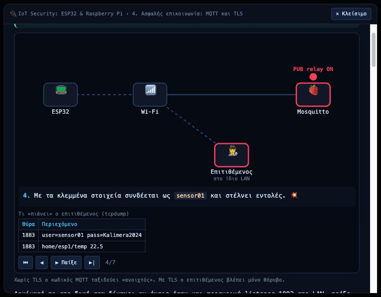

# ◉ NetWatch

Ζωντανός χάρτης της κίνησης του δικτύου σου + ανίχνευση επιθέσεων + OSINT για κάθε IP.

## Εκκίνηση

```bash
chmod +x run.sh
./run.sh            # πραγματική καταγραφή (ζητάει τον κωδικό του Mac για sudo)
./run.sh --demo     # προσομοίωση με ψεύτικη κίνηση και επιθέσεις
./run.sh --pcap samples/lan-attack.pcap   # αναπαραγωγή καταγεγραμμένης επίθεσης (χωρίς sudo)
```

**Εφαρμογή για Mac:** `./macapp/build.sh --install` φτιάχνει το **NetWatch.app** στο ~/Applications (με `--dmg` φτιάχνει και `dist/NetWatch.dmg` για να το μοιραστείς). Δεν χρειάζεται Xcode. Στη γραμμή μενού εμφανίζεται μια ασπίδα που γίνεται πράσινη, κίτρινη ή κόκκινη, με τον αριθμό των ειδοποιήσεων. Από το μενού της βλέπεις την τελευταία ειδοποίηση και την ετυμηγορία του Wi‑Fi, τρέχεις έλεγχο Wi‑Fi και αλλάζεις ανάμεσα σε Live, Demo και pcap. Ο πίνακας ανοίγει σε δικό του παράθυρο. Για το Live ζητάει τον κωδικό του Mac στο κανονικό παράθυρο του macOS.

Με `--pcap` ανοίγεις οποιοδήποτε αρχείο .pcap/.pcapng (π.χ. από Wireshark). `--speed 10` = 10x πιο γρήγορα, `--loop` = επανάληψη.

Κάθε ειδοποίηση έχει κωδικό **MITRE ATT&CK** (π.χ. T1046), υπάρχει εξαγωγή **αναφοράς συμβάντος (JSON)**, κουμπί 📸 για εικόνα του χάρτη, και 123 αυτόματα tests (`.venv/bin/python -m pytest`).

### Νέα
- **Beaconing (C2)**: συσκευή που συνδέεται σε server «με ρολόι» → πιθανό malware.
- **DNS tunneling** και **DGA**: δεδομένα κρυμμένα στο DNS, botnets που ψάχνουν τυχαία domains.
- **Νέα συσκευή στο Wi‑Fi**: οι συσκευές θυμούνται στο ιστορικό, ειδοποίηση για κάθε άγνωστη.
- **Threat intel**: λίστες Feodo Tracker / Spamhaus / FireHOL, και AbuseIPDB score με δικό σου API key.
- **JA3**: «δακτυλικό αποτύπωμα» του προγράμματος σε κάθε σύνδεση TLS.
- **Ιστορικό (SQLite)** στην καρτέλα 🕓 Ιστορικό: ειδοποιήσεις ανά ώρα, αρχείο, όλες οι συσκευές.
- **Ειδοποιήσεις** στο Κέντρο ειδοποιήσεων του Mac, στο Telegram ή **στο κινητό με ntfy**, με κουμπί δοκιμής.
- **config.yaml**: όρια, on/off ανά ανιχνευτή, allowlist. Ξεκίνα με `cp config.example.yaml config.yaml`.
- **Docker** (μόνο Linux): `docker compose up`.
- **Κωδικοί χωρίς κρυπτογράφηση**: ειδοποίηση όταν κωδικός στέλνεται «ανοιχτά» (FTP, Telnet, HTTP, POP3, IMAP, SMTP). Ο κωδικός δεν αποθηκεύεται και δεν εμφανίζεται ποτέ.
- **🛡 Έλεγχος**: βαθμός ασφάλειας A–F για το δίκτυό σου, επικίνδυνες υπηρεσίες στο LAN (Telnet, RDP, SMB, UPnP…) και τι να διορθώσεις.
- **🎓 Κουίζ**: ερωτήσεις για επιθέσεις, θύρες, TCP και MITRE, και από τις πραγματικές ειδοποιήσεις του δικτύου σου.
- **🔴 Pentest** (μόνο για το δικό σου δίκτυο):
  - **σαρωτής LAN**: συσκευές, ανοιχτές θύρες, λογισμικό και έκδοση, έλεγχος TLS
  - **CVE**: γνωστές ευπάθειες κάθε έκδοσης από το NVD
  - **Shodan**: τι βλέπει το Internet για τη δημόσια IP σου
  - **purple-team lab**: θορυβώδεις και αθόρυβες επιθέσεις, για να δεις πότε τις πιάνει η άμυνα και πότε ξεφεύγουν
- **🧩 Κανόνες**: γράφεις τους δικούς σου κανόνες ανίχνευσης σε YAML. Τους δοκιμάζεις στα τελευταία πακέτα πριν τους αποθηκεύσεις και τους βγάζεις ως **Sigma** ή **Suricata**.
- **🚩 CTF**: 3 επίπεδα ανάλυσης κίνησης (εύκολο, μέτριο, δύσκολο). Στο δύσκολο, κανένας ανιχνευτής δεν βλέπει την επίθεση και πρέπει να γράψεις κανόνα που την πιάνει χωρίς false positives.
- **☕ Wi‑Fi Guard** (για καφετέριες, αεροδρόμια, ξενοδοχεία): «είμαι ασφαλής σε αυτό το Wi‑Fi;». Ελέγχει κρυπτογράφηση, **evil twin** (ψεύτικο δίκτυο με το ίδιο όνομα), captive portal, **DNS hijacking**, **TLS interception**, ARP spoofing, και στο Mac σου firewall/stealth, VPN, ιδιωτική διεύθυνση Wi‑Fi και υπηρεσίες κοινής χρήσης ανοιχτές στο δίκτυο. Για κάθε πρόβλημα λέει πώς το διορθώνεις. Σε live τρέχει μόνο του σε κάθε νέο δίκτυο. Δεν αλλάζει καμία ρύθμιση.
- **🧭 Αρχική**: οδηγός «από πού ξεκινάω;» με 7 ερωτήσεις, καθεμία με ζωντανή απάντηση και κουμπί προς τη σωστή ενότητα. Από κάτω η **🛣 Διαδρομή** δείχνει βήμα-βήμα από πού περνά η σύνδεση σε ένα site: DNS, Wi‑Fi, router, πάροχος, όλοι οι routers στη διαδρομή (traceroute με χώρα και εταιρεία) και server, μαζί με το ποιος βλέπει τι. Οι ενότητες χωράνε σε μία σειρά, με μενού «☰ Ενότητες» σε κάρτες. Κάθε ειδοποίηση λέει με απλά λόγια αν είναι κακό.
- **🕵 Ανωνυμία**: τι βλέπει κάθε site για σένα (IP, πόλη, πάροχος), αν περνάς από **Tor** ή VPN, και αν κάτι «στάζει»: **DNS leak**, **IPv6 leak**, **WebRTC leak**, ζώνη ώρας και γλώσσα. Σε live με VPN σε ειδοποιεί όταν DNS ή IPv6 βγαίνουν έξω από το τούνελ. Αν ανοίξεις το Tor Browser, δείχνει και την IP εξόδου του Tor.
- **📱 Εφαρμογές**: ποια εφαρμογή μιλάει με ποιον. Για κάθε εφαρμογή βλέπεις τους προορισμούς της με όνομα, και με 🔴 όσους είναι **trackers** διαφημίσεων, παρακολούθησης ή τηλεμετρίας (Google Analytics, Meta Pixel, Hotjar, Firebase, Sentry…).
- **🪤 Παγίδα (honeypot)**: ψεύτικες υπηρεσίες (SSH, Telnet, σελίδα router, εκτυπωτής…) που κανείς νόμιμος δεν αγγίζει. Όποιος συνδεθεί σού βγάζει ειδοποίηση μαζί με το τι έστειλε. Δεν εκτελεί τίποτα και είναι **κλειστή** μέχρι να την ανοίξεις.
- **🚫 Μπλοκ με ένα κλικ**: κουμπί «Μπλόκαρε» στις ειδοποιήσεις. Στο Mac βάζει κανόνα στο τείχος **pf** (anchor `com.apple/netwatch`) χωρίς να αλλάξει αρχεία συστήματος. Ο κανόνας φεύγει όταν ξεμπλοκάρεις ή κλείσεις το NetWatch. Δεν μπλοκάρει ποτέ εσένα ή τον router.
- **🎓 Ακαδημία**: μαθήματα με **animations πακέτων** βήμα-βήμα, κώδικα, κουίζ, **προσομοιωτή Cisco IOS** και εξάσκηση subnetting. Δύο διαδρομές: **CCNA 200-301** από το μηδέν μέχρι την εξέταση, χωρισμένη στους τομείς της, με τελικό διαγώνισμα. Και **IoT Security με ESP32 & Raspberry Pi**: hardening, MQTT με TLS, Secure Boot, flash encryption, υπογεγραμμένο OTA, με κώδικα Arduino C++, MicroPython, Python και bash.
- **⌨️ Τερματικό στα μαθήματα**: πατάς «▶ Τερματικό» κάτω από τον κώδικα, Enter, και η εντολή τρέχει στο Mac σου. Τρέχουν μόνο ασφαλείς εντολές δικτύου (ping, dig, curl, `nmap -sT` στο δικό σου δίκτυο…), ποτέ με sudo και ποτέ ως root. Για εντολές του Raspberry Pi σού προτείνει την αντίστοιχη του Mac.
- **🃏 Εργαλεία CCNA**: 303 κάρτες με επανάληψη (Leitner), πρόγραμμα μελέτης ως την ημερομηνία της εξέτασης, και διαγώνισμα με χρόνο και αποτέλεσμα ανά τομέα.
- **🔌 IoT μου**: βρίσκει τα ESP32 και Raspberry Pi σου στο δίκτυο και ελέγχει τι αφήνουν ανοιχτό: Telnet, MQTT χωρίς κωδικό ή TLS, σελίδες χωρίς HTTPS. Βρίσκει και brokers MQTT ή Telnet σε οποιοδήποτε μηχάνημα (π.χ. VM στο Proxmox). Δείχνει και τις εκδόσεις λογισμικού με γνωστά CVE. Κάθε πρόβλημα σε πάει στο μάθημα που το λύνει.
- **📨 Φύλακας MQTT**: συνδέεται στον broker σου μόνο για ανάγνωση, μαθαίνει τι είναι φυσιολογικό και σε ειδοποιεί για άγνωστο client, νέο topic, εντολή μέσα στη νύχτα ή συσκευή που σιώπησε.
- **🧅 Tor**: λίστα κόμβων εξόδου Tor και ειδοποίηση όταν μια συσκευή του σπιτιού (ειδικά IoT) μιλάει Tor.
- **🐤 Καναρίνι ESP32**: ένα ESP32 που παριστάνει ξεχασμένη κάμερα. Όποιος το αγγίξει σκανάρει το δίκτυό σου, και σε ειδοποιεί. Ψευδείς συναγερμοί πρακτικά δεν υπάρχουν.
- **🔬 «Εξήγησέ μου ένα πακέτο»**: ένα πραγματικό πακέτο σπασμένο σε επίπεδα OSI, με εξήγηση για κάθε πεδίο και σύνδεσμο στο μάθημα CCNA.
- **🏠 Home Assistant**: οι ειδοποιήσεις φαίνονται ως οντότητες στο HA (MQTT discovery), για αυτοματισμούς.
- **🌍 Συνήθειες συσκευών**: μαθαίνει με ποιες χώρες μιλάει κάθε συσκευή και σε ειδοποιεί όταν μιλήσει με καινούργια.
- **📄 Αναφορά εβδομάδας**: μία σελίδα (και PDF) με βαθμό, τι έγινε και τι να κάνεις.
- **🔐 TLS για τον broker**: το `tools/mosquitto-tls.sh` φτιάχνει CA, πιστοποιητικά και έτοιμη ρύθμιση για τον Mosquitto.
- **🛰 Agent**: τρέχει σε server του σπιτιού (Proxmox, Raspberry Pi) με HTTPS και token, για να βλέπεις όλο το δίκτυο. Οδηγός στο [docs/agent.md](docs/agent.md).
- **📡 Αισθητήρας ESP32**: firmware στο [`firmware/esp32-sentinel`](firmware/esp32-sentinel) που «ακούει» τον αέρα για **deauth επιθέσεις** και **evil twins** και τα στέλνει στο NetWatch μέσω MQTT με TLS. Είναι μόνο παθητικό.

  

- **Στρώματα OSI**: κλικ σε ένα πακέτο στην καρτέλα 📦 και βλέπεις τα L1–L7 με εξήγηση.

Ανοίγει μόνο του το http://127.0.0.1:8765 (μόνο τοπικά, όχι από άλλες συσκευές).

Επιλογές: `-i en0` interface, `-f "not port 22"` φίλτρο BPF, `--no-geo` χωρίς γεωεντοπισμό, `--no-rdns`, `--port 9000`.

## Τι βλέπεις

- **Παγκόσμιος χάρτης**: κάθε πακέτο είναι μια φωτεινή κουκκίδα που ταξιδεύει από/προς το σπίτι σου (⌂) και τον server στον κόσμο. Το χρώμα δείχνει πρωτόκολλο (HTTPS, QUIC, DNS, ICMP, ARP…), το **κόκκινο** = κίνηση από επιτιθέμενο.
- **Τοπικό δίκτυο (LAN)**: εσύ στο κέντρο, ο router, οι άλλες συσκευές (τηλέφωνα, TV, εκτυπωτές) και broadcast/multicast.
- **Επιθέσεις**: λίστα ειδοποιήσεων + κόκκινο pop-up για τις σοβαρές.
- **Προορισμοί**: πού πάει η κίνηση — IP, domain (από DNS και TLS SNI), χώρα, bytes. Με φίλτρο και ταξινόμηση.
- **Πακέτα**: ζωντανή ροή τύπου Wireshark.
- **Λεπτομέρειες (OSINT)**: hostname, domains, χώρα/πόλη/συντεταγμένες, ISP, ASN, αν είναι proxy/VPN/Tor ή datacenter, θύρες, πρωτόκολλα, με ποιους μιλάει, WHOIS με ένα κλικ, και σύνδεσμοι σε AbuseIPDB, Shodan, VirusTotal, GreyNoise, Censys, ipinfo, BGP.he.net, OTX. Για συσκευές του LAN: MAC + κατασκευαστής.

## Τι ανιχνεύει

| Επίθεση | Πώς |
|---|---|
| Port scan (TCP/UDP) | ≥20 διαφορετικές θύρες/στόχοι από μία IP σε 10s |
| Stealth scan NULL/FIN/XMAS | TCP με ασυνήθιστα flags (nmap -sN/-sF/-sX) |
| Brute force | ≥15 συνδέσεις σε SSH/RDP/SMB/FTP/VNC/βάσεις σε 30s |
| SYN flood (DoS) | ≥300 SYN προς εσένα σε 5s |
| ICMP flood | ≥100 ping από μία IP σε 5s |
| Network sweep (ping/ARP) | κάποιος ρωτάει για 30–40+ IP του δικτύου σε 10s |
| **ARP spoofing / MITM** | η MAC κάποιας IP (ειδικά του router) αλλάζει — κάποιος παριστάνει τον router |
| ARP flood | ≥60 ARP replies σε 5s |
| Rogue DHCP | δεύτερος DHCP server στο δίκτυο |
| DNS spoofing | απάντηση DNS από server που δεν ρωτήθηκε |
| Εισερχόμενη σύνδεση | SYN από Internet προς εσένα |
| Ύποπτη εξερχόμενη θύρα | σύνδεση σε 4444, 31337, 6667 κ.λπ. (backdoors/botnets) |

## Καλό να ξέρεις

- Σε Wi‑Fi βλέπεις **τη δική σου κίνηση** + broadcast/multicast/ARP όλου του δικτύου. Δεν βλέπεις την unicast κίνηση άλλων συσκευών — έτσι δουλεύει το switching/Wi‑Fi. Το ARP spoofing, τα sweeps και το rogue DHCP όμως τα πιάνει, γιατί είναι broadcast.
- Πίσω από router (NAT), επιθέσεις από το Internet φτάνουν μόνο αν έχεις ανοιχτές/προωθημένες θύρες. Τα περισσότερα «Internet» alerts θα έρθουν από το ίδιο το LAN.
- Ο γεωεντοπισμός γίνεται μέσω του δωρεάν **ip-api.com** (στέλνει τις δημόσιες IP προορισμών, όχι περιεχόμενο). Αν δεν το θέλεις: `--no-geo`.
- Τα όρια ανίχνευσης είναι στην αρχή της `detect()` στο `netwatch.py` — μπορείς να τα αλλάξεις.
- Αν μια συσκευή πάρει νέα IP από DHCP μπορεί να βγει ψευδώς θετικό ARP alert.
- Χρησιμοποίησέ το μόνο σε δίκτυα που σου ανήκουν ή έχεις άδεια να παρακολουθείς.
