<h1> NetWatch</h1>

**A live network-traffic map and intrusion-detection sensor in a single Python file.** Every packet on your network becomes an animated arc on a world map. NetWatch watches for scans, brute force, man-in-the-middle attacks, DoS, **C2 beaconing, DNS tunneling, DGA malware** and **known-bad IPs from threat-intel feeds**. It maps each alert to **MITRE ATT&CK**, keeps a SQLite history, can notify you on macOS or Telegram, and gives you OSINT on every IP it sees.

**▶ [Live online demo](https://gyuri1999.github.io/netwatch/)** (simulated traffic, runs in the browser) · **📚 [Academy](https://gyuri1999.github.io/netwatch/academy.html)**


[](../../actions/workflows/ci.yml)


> 🇬🇷 Ελληνική τεκμηρίωση: [README.el.md](README.el.md). The UI is in English and Greek (🇬🇧 EN / 🇬🇷 ΕΛ button).

---

## Features

| | |
|---|---|
| 🗺 **Live world map** | Packets fly between your home and each server, coloured by protocol (HTTPS, QUIC, DNS, ICMP, ARP…). Zoom and pan go down to city level, with country labels. |
| 🏠 **LAN view** | Shows you, the router and every device on the local network. MITM attacks and sweeps show up here. |
| 🚨 **18 detectors** | Port/UDP scans, NULL/FIN/XMAS stealth scans, brute force, SYN/ICMP flood, ping and ARP sweeps, ARP spoofing, ARP flood, rogue DHCP, DNS spoofing, inbound probes, C2-style ports, **C2 beaconing**, **DNS tunneling**, **DGA domains**, **new devices**, **threat-intel matches**, **passwords sent in cleartext**. |
| ⛔ **Threat intelligence** | Downloads Feodo Tracker (botnet C2), Spamhaus DROP and FireHOL level1 once a day, giving about 4,500 CIDRs with prefix-bucketed O(1) lookups. One click checks an IP's AbuseIPDB score (with your own API key). |
| 🔏 **JA3 fingerprints** | Fingerprints the client application of every TLS ClientHello (with GREASE removed), even though the traffic is encrypted. |
| 🛡 **Security audit** | A passive home-network check graded A–F. It lists cleartext logins (FTP, Telnet, POP3, IMAP, SMTP, HTTP Basic and form posts), risky services listening on the LAN (Telnet, RDP, VNC, SMB, UPnP, open databases…), recent attacks, unknown devices and unencrypted HTTP/DNS, each with a fix. Usernames are masked and **passwords are never stored or shown**. |
| 🎓 **Learning mode** | Click any packet to see it split into OSI layers (L1–L7), each with a plain-language explanation. A quiz tab asks about attacks, ports, TCP flags, MITRE tactics and defence steps, and also builds questions from **the alerts your own network just raised**. |
| 🔴 **Pentest & network technician toolkit** | Five sub-tabs. **Scan**: an active LAN scanner with profiles (quick, top 1,000, all 65,535 ports for up to 4 hosts, custom ranges) and optional **UDP probes** (SNMP `public`, DNS, NTP, mDNS, SSDP). It does banner grabbing with version detection, TLS checks, vendor lookup from the MAC, an OS guess from the TTL, and device names from DNS, mDNS, NetBIOS and UPnP. It shows **what changed since the last scan** (new devices, newly opened ports) and exports **CSV, JSON or Markdown** reports. Each detected version has a one-click **CVE lookup** in NVD. **Tools**: ping with jitter and loss, a `dig`-style DNS lookup, a **DNS comparison** (router vs Cloudflare, Google and Quad9, which catches hijacking), a port check (open/closed/filtered), an HTTP/TLS inspector (redirects, security headers, certificate expiry, SANs and trust), Wake-on-LAN, name discovery, your interfaces, and a **subnet calculator** with a wildcard mask for ACLs. **Internet view**: what Shodan InternetDB sees on your public IP. **Lab**: a purple-team lab that runs loud and stealthy versions of 7 attacks through the detection engine. **My test**: declare “I'm testing from 192.168.1.19 for 30 minutes”. Scans and port checks only accept private ranges. |
| 🧪 **Your test vs someone else** | Alerts caused by NetWatch's own scans and tools, or by a device you declared as your test box, are labelled **🧪 Your test**. They stay visible, so you see what your defences catch, but they don't notify your phone, don't trigger playbooks or Home Assistant, don't raise the status and aren't saved to history. Every other alert says where it came from: **👤 Another device**, **🌐 From the Internet**, or **💻 From you — not a test** (worth checking, e.g. malware). |
| 🗂 **One screen at a time** | A sidebar groups everything by task (Live, Protection, My network, Tools, Learning), following the UniFi, Wazuh and Cisco XDR pattern. The **live map** and the **home network** map each get the full screen, with a narrow drawer for alerts, details and packets. Every other section is a full page. The **Home** page puts the seven guided steps in a grid, then the latest alerts and shortcuts. On a phone the sidebar becomes a ☰ drawer. |
| 👷 **Technician / 🎓 Learning modes** | First run asks how you'll use it. **Technician**: dense home with KPIs (devices, high alerts in the last hour, homelab up/down, last scan and its diff), a quick-tool bar and one-click Wireshark filters. **Learning**: the guided steps, a “keep learning” card, and a plain-language explanation under every tool result. The sidebar order follows the mode. |
| ⌘ **Command palette** | `Ctrl/⌘ + K` (or `/`) from anywhere: jump to any section, or type a command and it runs right away — `ping 192.168.1.1`, `dns github.com MX`, `ports 192.168.1.17 22,1883`, `http https://…`, `wol aa:bb:…`, `subnet 10.0.0.37/27`, `scan 192.168.1.0/24`, `filter dns`. Familiar aliases work too (`dig`, `nslookup`, `nc`, `curl`, `nmap`, `ipcalc`). |
| 🦈 **Wireshark notes + live filters** | 167 useful display filters, capture (BPF) filters, tshark/tcpdump/dumpcap commands and Wireshark shortcuts, searchable and grouped (basics, TCP problems, DNS, web/TLS, LAN/CCNA, Wi‑Fi, threat hunting). Any display filter that NetWatch can evaluate (52 of them) runs on the live packet list with **▶ To packets**. The packets view has a Wireshark filter bar (`ip.addr == 192.168.1.0/24 && tcp.port in {22 443}`, `contains`, `matches`, CIDR, ranges). |
| 🛰 **Where each device sends packets** | In any LAN device's details: every destination it talked to this session (name from DNS/SNI, country, ISP, ports, bytes), with suspicious and unencrypted ones (HTTP, Telnet, MQTT…) highlighted. **🛣** opens the hop-by-hop route from that device (with traceroute) and who can see what. **🦈** filters the packets to that conversation. It also explains how to see other devices' traffic: run NetWatch on the router or Proxmox bridge, a SPAN/mirror port, or a separate IoT VLAN. |
| ✨ **Motion** | Short ease-out transitions: pages slide in with staggered cards, numbers count up, new alerts flash once, tool results fade in with a skeleton while loading, and buttons respond on press. Everything turns off with the OS “reduce motion” setting. |
| 🎨 **Themes & accessibility** | **Dark, light or auto** (follows the OS), six accent colours, a **colour-blind mode** (blue/orange instead of red/green, with icons on every severity) and a **motion** switch (full / reduced / off, which also respects the OS setting). Page changes use the View Transitions API. The live map and the LAN view stay dark so the arcs remain readable. `?theme=light` works as a deep link. |
| 📺 **NOC / wall mode** | `?noc=1` or the palette: fullscreen, big KPIs (packets, traffic, devices, high and medium alerts in the last hour, homelab up), a clock, a ticker of the latest alerts, and the map and LAN view rotating every 30 s. It keeps the screen awake (Wake Lock). Made for an old tablet or TV next to the rack. |
| 🎉 **Small touches** | High alerts send a shockwave from the target on the map and tint the edges red, LAN devices "breathe" with their traffic and new devices get a yellow ring, Sankey flows grow in and highlight on hover, buttons show a spinner then ✓, a first-visit tour, and confetti for CTF flags, a passed mock exam or a completed daily goal. |
| 🌊 **NetFlow / sFlow collector** | Point your router, switch or `softflowd` at UDP 2055 (NetFlow v5/v9, IPFIX) or 6343 (sFlow v5). Top talkers, destinations and conversations over a sliding window, per-device drill-down, and alerts on unusual upload volume. Accepts flows only from the exporters you allow. Self-written decoders, no extra dependencies. |
| 📶 **SNMP & topology** | Polls routers and switches over SNMP v2c (read-only): uptime, every interface with traffic, utilisation, errors and discards, and **LLDP/CDP neighbours**, drawn as a hierarchical topology from the router down. Alerts on a link going down, error spikes and saturated ports. |
| 📜 **Syslog server** | RFC 3164 and 5424 over UDP and TCP (port 5514 by default, since 514 needs root). Search by text, host and severity, per-host counts, built-in alerts (failed logins, link down…) and your own `match` rules. Only allowed sources are accepted. |
| 🗂 **IPAM** | Like NetBox or phpIPAM: subnets with VLAN, gateway and DHCP pool, a 256-cell map of every address (used, free, reserved, DHCP, stale), **IP conflicts** (one IP, two MACs), static IPs inside the DHCP pool, reservations nobody uses, the next free addresses, notes per IP, and CSV/JSON export. Reads dnsmasq or ISC DHCP leases if NetWatch runs on the DHCP server. |
| ⏱ **Latency (SmokePing-style)** | Ten pings a minute to the router, the ISP's first hop, public DNS and your own targets. Shows median, jitter and loss as SmokePing-style smoke charts over 3 h, 24 h or 7 days, compares against a baseline, and finds the **worst hours of the day**. It tells you whether a problem is your Wi‑Fi, your router or your ISP. |
| 🚀 **Speed tests** | **iperf3** to any private LAN host (uses the installed `iperf3`; run `iperf3 -s` on the target) and an optional internet test against Cloudflare's speed endpoints, which only runs when you confirm. Keeps a history chart. |
| 📡 **Wi‑Fi survey** | Every nearby network with channel, band, signal and security. Shows how crowded each channel is, recommends a better one (skipping DFS if you want) and flags open or WEP networks nearby. |
| 📦 **PCAP ring buffer** | The last 5 minutes of packets stay in memory (64 MB max). Every alert gets a **⬇ .pcap** button with the packets from 60″ before to 30″ after it, ready for Wireshark. Nothing is written to disk. |
| 🛠 **Operations** | **Maintenance windows** (weekly, overnight or one-off, optionally per host) and a one-click mute for 30′/1h/4h: alerts still show but aren't sent and playbooks don't run. More notification channels: **Discord, Slack, a generic JSON webhook and email** (SMTP with STARTTLS). A **Prometheus `/metrics`** endpoint for Grafana, and **read-only viewer tokens** for a wall screen or Prometheus in agent mode. |
| 🧅 **Tor circuit** | When Tor runs with a control port, NetWatch shows the live 3-hop circuit (guard → middle → exit) with country flags, bandwidth and a map with coloured arcs, plus a one-click **New identity** (NEWNYM). Read-only, localhost control port only. In device details, a **🧅 Tor node?** button checks any IP against Onionoo (Tor Metrics). |
| 🔒 **VPN kill-switch & split-tunnel** | Watches whether your VPN carries all traffic (full tunnel), only some (split), or is off. A one-click **kill-switch test**: arm it, drop the VPN, and NetWatch tells you whether any app leaked outside the tunnel. Shows WireGuard and Tailscale peers (handshake, traffic, sparklines) and alerts when a peer is lost. |
| 🔐 **Encrypted / bypass DNS** | Which devices send DNS over **DoH, DoT or DoQ**, or to a foreign resolver, bypassing your Pi-hole or router — with the provider named. Also reads **Pi-hole or AdGuard Home** stats (queries, blocked %, top blocked domains and clients) and warns if filtering is turned off. |
| 📹 **Camera exposure check** | A defensive check of **your own LAN only** (private ranges, read-only): finds cameras and DVRs with an open stream, a no-password web UI, old firmware or P2P cloud (XMeye/iCloud-cam), and tells you exactly how to close each hole. It never tries passwords and never touches a public IP. |
| 📥 **Suricata & Zeek import** | Tails Suricata `eve.json` and Zeek logs (notice/weird, TSV or JSON) and folds their alerts into the same list, or you can drag-drop a log file to import it. Each alert keeps its signature, severity and the hosts involved. |
| 🔏 **Certificate Transparency** | Watches crt.sh for new TLS certificates issued for **your** domains and alerts on anything unexpected — an issuer you don't use, or a subdomain you didn't create (a sign of phishing or a breach). |
| 🖐 **Browser fingerprint & EXIF** | In the privacy tab: a **fingerprint test** (like the EFF's Cover Your Tracks) that estimates how unique your browser is, in bits, from canvas, WebGL, audio, fonts, screen and more — all computed locally. And an **EXIF/GPS reader**: drop a photo to see what it reveals (location, phone, time) and download a **cleaned copy**. A DNS-leak test without third parties (whoami.akamai.net) and an IPv6-privacy check round it out. |
| 📡 **Trackers & telemetry** | Which device on your network phones home to **ads, analytics and telemetry** endpoints (Google Ads, Meta Pixel, Firebase, Crashlytics…), read from the SNI/DNS names NetWatch already sees — with a live animated **device → tracker-type** flow (little packets travel the links). Shows what your **Pi-hole/AdGuard** already blocked today. Passive; it never blocks on its own. |
| 🖥 **Menu-bar dashboard (macOS)** | The Mac app's menu-bar popover is a live status card — threat level, a traffic sparkline, device/alert/homelab tiles, Wi‑Fi verdict and mute state — with quick actions: jump to any tab, open the NOC wall, run a leak check, and mute alerts for 30′/1h/4h. |
| 🏠 **Home network map** | Every LAN device with a real **name, icon and manufacturer** (50k-entry OUI database plus DNS/mDNS names and open ports), grouped into network gear, computers/servers, phones, IoT, home devices and unknown. Large groups spread over several columns. Rename any device (✏️, stored by MAC). |
| 🇬🇧 **English / Ελληνικά** | One button switches the whole UI, the Academy (94 lessons, 315 flashcards), alert explanations and phone notifications (`lang: en` in `config.yaml`). Details in [`i18n/README.md`](i18n/README.md). |
| 🧩 **Custom detection rules** | Write rules in YAML: IPs/CIDRs and keywords like `me`, `local` or `public` with `!` negation, port ranges, TCP flags, DNS/SNI/HTTP-host globs, and thresholds with `distinct` counting. **Test a rule against the last 5,000 packets** before saving it. Every rule exports to **Sigma** (for SIEMs) and **Suricata** (for IDS). It ships with 5 starter rules in [`rules/`](rules/default.yaml). |
| 🚩 **CTF** | Three traffic-analysis challenges built on pcaps. Loading a level swaps the live view for that capture: *LAN intruder* (easy), *the silent visitor* (DGA plus C2 beaconing from an infected TV, medium) and *the patient one* (a slow scan that slips under every built-in detector, hard). The hard level ends with **writing a rule that catches the attacker with zero false positives**, checked by replaying the pcap through your rule. Answers are stored only as SHA-256 hashes. |
| ☕ **Wi‑Fi Guard** | Am I safe on this café Wi‑Fi? Checks the **network** (open/WEP/shared-password encryption, **evil twins** with the same name but different security, captive portals, **DNS hijacking** against resolvers with fixed IPs plus NXDOMAIN rewriting, **TLS interception** via verified handshakes, ARP spoofing of the gateway) and **your Mac** (firewall and stealth mode, VPN, private Wi‑Fi address, sharing services listening on the Wi‑Fi). Gives a verdict with a Mac-specific fix for every problem. In live mode it **re-runs automatically whenever you join a new network** and raises T1557 alerts. Mark your home network as trusted to skip public-only warnings. It only reads settings and never changes them. |
| 🧭 **Start page & route view** | The first screen is a guide: seven questions (Am I safe on this Wi‑Fi? Is anyone attacking me? Who is on my network? Where does my traffic go? Am I visible online? How safe is my home? What should I learn?), each with a live answer and a button to the right section. Below it, **Route** picks any destination and walks the path step by step: DNS lookup, Wi‑Fi, router, ISP, every router on the way (a real `traceroute` with each hop geolocated) and the server. Each step says **who can see what**, and the view ends by saying whether the content is encrypted. All 21 sections live in one compact row with a **☰ Sections** card menu. Every alert also carries a plain-language verdict (🟢 usually harmless / 🟡 worth checking / 🔴 likely a problem) with a first step, and known-harmless cases (such as your own Tor connecting to relays) are marked as expected. |
| 🕵 **Anonymity & leak test** | Shows what every website learns about you: IP, city, ISP, and whether the IP is flagged as a VPN or datacenter. Detects **Tor** (Tor Browser on port 9150 or the `tor` daemon on 9050) and compares your exit IP through its own minimal **SOCKS5 client with remote DNS**. Runs a **DNS leak test** (which resolvers actually see your lookups), an **IPv6 leak** check, a **WebRTC leak** check (the STUN-reflected IP your browser hands to any page) and a **timezone/language** consistency check. It grades your anonymity from none to Tor-level. In live mode it also **passively** raises alerts when a full-tunnel VPN is up but DNS or IPv6 still leaves the physical interface. The check only runs when you click it and lists every service it contacts. |
| 📱 **Apps & trackers** | Which app talks to whom. It reads each process's open connections (`lsof`), names every destination from the DNS answers and SNI it has seen (or reverse DNS), and flags **ad, analytics and telemetry trackers** (Google Ads/Analytics, Meta Pixel, Hotjar, Firebase, Sentry…) per app, with advice on blocking them. |
| 🪤 **Honeypot** | Opt-in decoy services (fake SSH, Telnet, router admin page, printer, RDP, VNC on ports above 1024). Nobody legitimate touches a service that doesn't exist, so any connection raises a high-severity alert that includes what the visitor typed (for example a Mirai-style `root / xc3511` attempt). It never executes anything: it shows a fake banner, reads at most 1 KB for 5 seconds and closes. It is **off by default**. |
| 🚫 **One-click block** | A **Block** button on alerts. On macOS it loads a pf table into the `com.apple/netwatch` anchor, which the stock `/etc/pf.conf` already evaluates, so no system file is edited. It enables pf with a reference token, and both are removed when you unblock or quit. On Linux it uses iptables. It refuses to block you or your router, shows the exact rules, and without root shows the commands to run yourself. |
| 🎓 **Academy** | A built-in course engine with step-by-step **animated packet scenes** (SVG with play/step controls and tables that fill as the scene runs), syntax-highlighted code with copy, quizzes, a guided **Cisco IOS CLI simulator**, an endless **subnetting trainer** and links into the live tabs. Two tracks are included. **CCNA 200-301** runs from zero to exam level, organised by the official exam domains, and ends in a mock exam. **IoT security with ESP32 & Raspberry Pi** covers hardening, MQTT over TLS, Secure Boot, flash encryption, signed OTA and segmentation, with Arduino C++, MicroPython, Python and bash examples. Lessons are plain JS files in [`academy/`](academy/FORMAT.md), and progress is kept in the browser. |
| 🔌 **My IoT devices** | Finds your **ESP32/ESP8266 and Raspberry Pi** boards by MAC vendor (Espressif and Raspberry Pi OUIs) and name, then checks what they expose. It flags Telnet, plain-text MQTT, HTTP without TLS, VNC and SMB. For MQTT it sends a real `CONNECT` with no credentials and reads the `CONNACK`, to tell whether the broker is open to anyone. It also reads software versions from banners (OpenSSH, HTTP `Server:`, and Mosquitto via the MQTT guard), marks known CVEs offline and has a 🔎 NVD lookup button. *Check* also sweeps your /24 for MQTT brokers and Telnet on any machine (for example a broker in a Proxmox VM) and recognises newer Espressif OUIs in macOS's short `arp` MAC format. Every finding links to the Academy lesson that fixes it. It never tries passwords. |
| 📨 **MQTT guard** | Connects to your Mosquitto broker as a **read-only** user and learns what normal looks like for 15 minutes. It learns which client ids connect (from `$SYS/broker/log` with `log_dest topic`), which topic patterns exist, and how often each device publishes. After that it alerts on an **unknown client**, a **new topic**, a **command topic (`…/set`, `relay`…) between 00:00 and 06:00**, and a **device that went silent**. Live message view. What it learns persists across restarts. |
| 🐤 **ESP32 canary** | [`firmware/esp32-canary`](firmware/esp32-canary) turns an ESP32 into a fake forgotten IP camera: fake Telnet and a fake HTTP admin page that returns 401, advertised over mDNS. Nobody legitimate touches it, so every connection becomes a **«Καναρίνι ESP32»** alert that names the IP that touched it. Passwords are never kept: only the username is reported. Events are rate-limited, it is MQTT/TLS like the sentinel, and CI compiles it. |
| 🔬 **Explain this packet** | From any host's detail page you can open a recent real packet split into **OSI layers** (Ethernet → IP → TCP/UDP → DNS…). Every header field has a one-line explanation (TTL, DF, flags, window, EtherType…) and a link to the matching CCNA lesson. Only the first 128 bytes are kept, in memory only, and the payload is shown as a length, never its content. |
| 🏠 **Home Assistant** | MQTT discovery creates a «NetWatch» device in HA with an attack binary sensor, last alert (with attributes), alerts per hour, LAN device count and security score. Every alert is also published as JSON on `netwatch/alerts` for automations. |
| 🌍 **Device baselines** | For 24 hours NetWatch learns which countries each LAN device talks to (keyed by MAC). After that, a new country raises **«Νέα χώρα για συσκευή»**, rated medium for IoT boards. |
| 📄 **Weekly report** | `/report?days=7` is one printable page (save it as PDF). It has the score, alerts per day and by type, top actors, new devices, IoT findings, the MQTT broker and device countries, plus a prioritised «what to do this week» list. |
| 🔐 **Broker TLS helper** | `tools/mosquitto-tls.sh <broker IP>` creates your own EC CA and a broker certificate (SAN = IP/DNS), a ready `mosquitto.conf` snippet (8883 with TLS, 1883 bound to localhost) and `ca_cert.h` for the ESP32s, then prints the copy and test commands. |
| 🧅 **Tor awareness** | The Tor exit list is a threat-intel feed of its own kind: it is labelled as Tor rather than malicious. A LAN device talking to Tor (exit IPs or ports 9001/9030) raises an alert, rated **high** if it looks like IoT and expected if it is your own Tor Browser. Inbound connections from exit nodes are flagged as low. |
| 🛰 **Agent mode** | `--agent` runs NetWatch on a home server (Proxmox VM/LXC, Raspberry Pi, `docker compose up`) and serves it on the LAN over **HTTPS with a self-signed cert** (the fingerprint is printed at startup) and a **secret token** (HttpOnly/Secure/SameSite=Strict cookie). POSTs must be same-origin, and the shell and shutdown endpoints are disabled. Put it on a mirror port to see the whole house; see [docs/agent.md](docs/agent.md). |
| ⚡ **Playbooks (automatic responses)** | «When X happens → do Y», written in `config.yaml` and **off by default**. A rule matches an alert type prefix, a minimum severity and/or whether the actor is on the LAN, and runs `block` (pf, with an expiry such as 60 minutes), `notify` (always sent, even under `min_severity`) or `mqtt` (publishes to `netwatch/playbook/<name>` so Home Assistant can react). Guard rails: it never blocks this computer, the router or anything on the allowlist, it ignores expected (benign) and lab alerts, at most `max_per_hour` actions per playbook stop an attacker from spoofing IPs to make you block your whole network, `dry_run: true` only logs what would happen, and every action in the ⚡ tab has an **Undo** button. |
| 🩺 **Homelab health** | Is the Proxmox host up? The broker? Home Assistant? The ESP32 in the garden? Light checks every 60 s (TCP connect, one HTTP GET, or a ping) with latency sparklines. A service is only marked down after **2 failures in a row** («Υπηρεσία εκτός» / «Υπηρεσία επανήλθε»), and TLS services warn **14 days before the certificate expires**. With no config it watches the router and your configured broker. |
| 📱 **Academy on your phone (PWA)** | [`academy.html`](academy.html) runs the same course engine without the NetWatch server, so it can be hosted on GitHub Pages and **installed to the home screen**. A service worker keeps every lesson offline. **«⏱ 10′ σήμερα»** is a daily session: up to 12 due flashcards, 5 quiz questions (the ones you got wrong first) and, for CCNA, one subnetting drill from memory, with a 🔥 streak. Progress stays in that browser. |
| 🔏 **Signed OTA for the ESP32s** | Both sketches can update over the air behind `OTA_ENABLE`. Firmware is signed with Ed25519 ([`tools/ota/ota_sign.py`](tools/ota)), the device refuses any image whose signature or version doesn't check out, and every accepted or rejected update raises an alert (**OTA rejected** is high severity). |
| 🌍 **Live demo on GitHub Pages** | [`tools/build_static_demo.py`](tools/build_static_demo.py) records a demo session into static files (no personal data), and [`.github/workflows/pages.yml`](.github/workflows/pages.yml) publishes it together with the standalone Academy. |
| 🏡 **Real homelab guide** | [`docs/homelab-setup.md`](docs/homelab-setup.md) walks through Mosquitto with TLS, users and ACLs, `config.yaml`, flashing the ESP32s and a final checklist. |
| 📡 **ESP32 Wi‑Fi sensor** | [`firmware/esp32-sentinel`](firmware/esp32-sentinel) is passive ESP32 firmware that hears what a laptop can't. It hops channels in promiscuous mode to count **deauth/disassoc floods**, and scans for **evil twins** and unknown access points that copy your SSID. It reports over **MQTT with TLS** using ESP-IDF's esp-mqtt with your own CA, and NetWatch subscribes (`paho-mqtt`) and raises alerts. It never transmits anything offensive, and CI compiles it with `arduino-cli`. |
| ⌨️ **Academy terminal** | Each bash example has a **▶ Terminal** button, so you can press Enter and run it on your Mac. Only an allowlist of read-only network tools runs (ping, dig, traceroute, curl, openssl, `nmap -sT` on private ranges…). There is no shell, so `;`, `&&`, redirections and `$(…)` are rejected. Nothing runs with `sudo`, and commands never run as root, even in live mode. Linux/Pi-only commands (`ip`, `apt`, `systemctl`) get the macOS equivalent as a one-click suggestion. |
| 🃏 **CCNA study tools** | **303 flashcards** with Leitner spaced repetition, a **study plan** that spreads the remaining lessons until your exam date (the last week is kept for review), and a **timed mock exam** (20/30/60 questions) drawn from the lesson quizzes using the official domain weights. It scores each domain, reviews your mistakes, and tracks mastery per domain. |
| 🕓 **History** | SQLite stores alerts, traffic per minute and every device ever seen. A history tab shows alerts per hour, a searchable alert archive and a device inventory. |
| 🔔 **Notifications** | macOS Notification Center (also under `sudo`), Telegram bot, **ntfy** push to your phone (public ntfy.sh with a random topic, or your own server), **Discord, Slack, a webhook or email**, with a severity floor, cooldown, maintenance windows and a 📱 test button. |
| ⚙ **YAML config** | Every threshold, per-detector on/off switches, and an allowlist of IPs, MACs and domains. |
| 🐳 **Docker** | `docker compose up` on any Linux host (host networking with `NET_RAW`). |
| 🎯 **MITRE ATT&CK** | Every alert carries its technique ID and tactic, and a coverage grid shows which tactics were observed. |
| 🔎 **Attacker analysis** | Lists the ports and services an attacker targeted, *why* those matter, who the victims were, an activity timeline and a plain-language verdict. |
| 🌍 **OSINT** | Shows geolocation, ISP, ASN and proxy/VPN/hosting flags for each IP, plus reverse DNS and domains learned from DNS answers and TLS SNI. WHOIS runs in one click, and there are links to AbuseIPDB, Shodan, VirusTotal, GreyNoise, Censys and OTX. |
| ▶ **PCAP replay** | Feeds any `.pcap`/`.pcapng` through the same engine at real time or faster. Needs no root. |
| 📄 **Incident report** | Exports alerts and attacker profiles as JSON with one click, and the map as a PNG. |
| 📚 **Built-in training** | Each alert explains *what it is, how it works, the risk and what to do*. Clicking a packet explains it in plain words. There are also a protocol/port glossary and context-aware security tips. |

## Screenshots

| | |
|---|---|
| 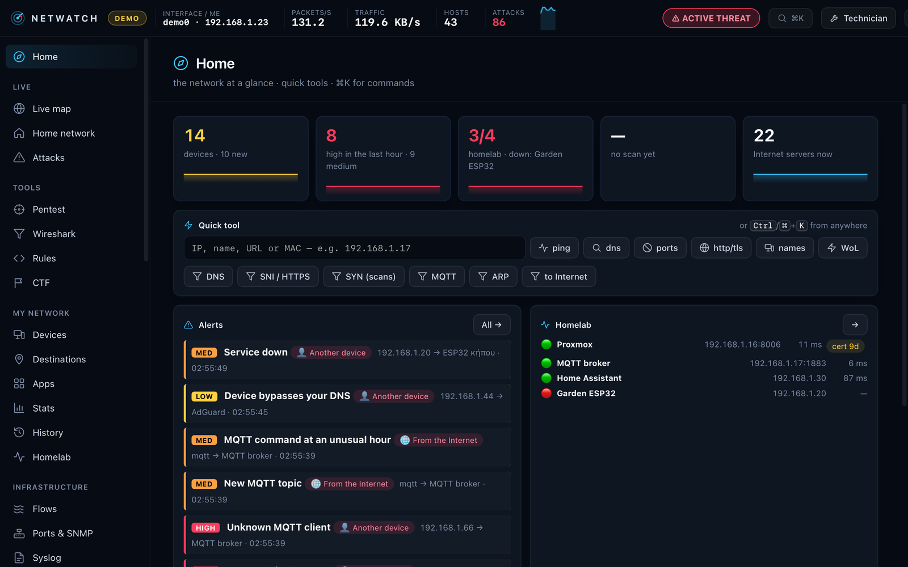 **Technician home**: devices, alerts, homelab, last scan, quick tools | 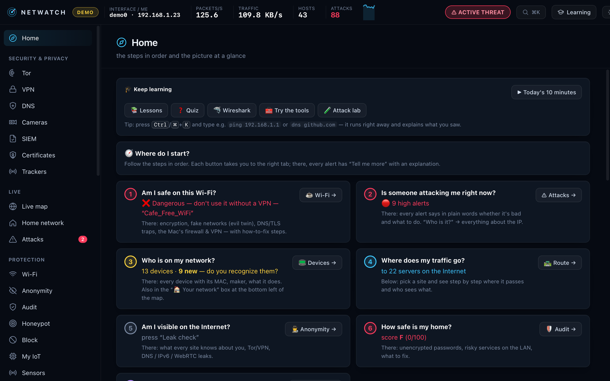 **Learning home**: seven guided questions, each with a plain answer |
| 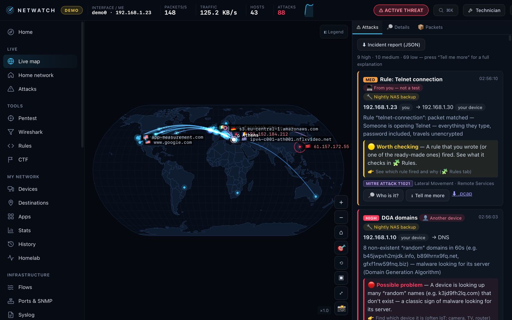 **Live map**: every connection as an arc, alerts in a side drawer | 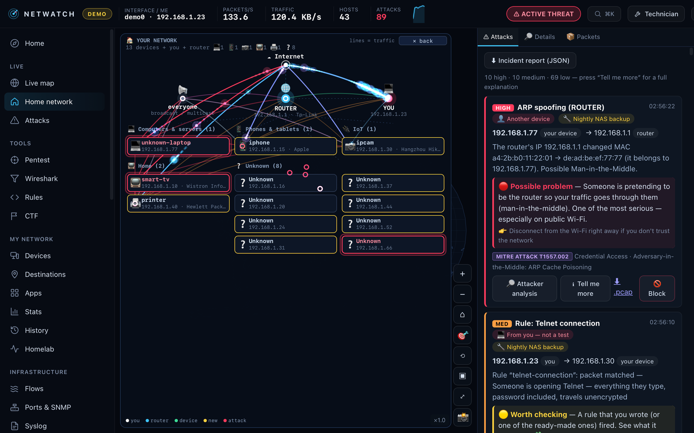 **Home network**: devices grouped by type, live links |
|  **Where a device sends packets**: names, countries, ports, unencrypted traffic | 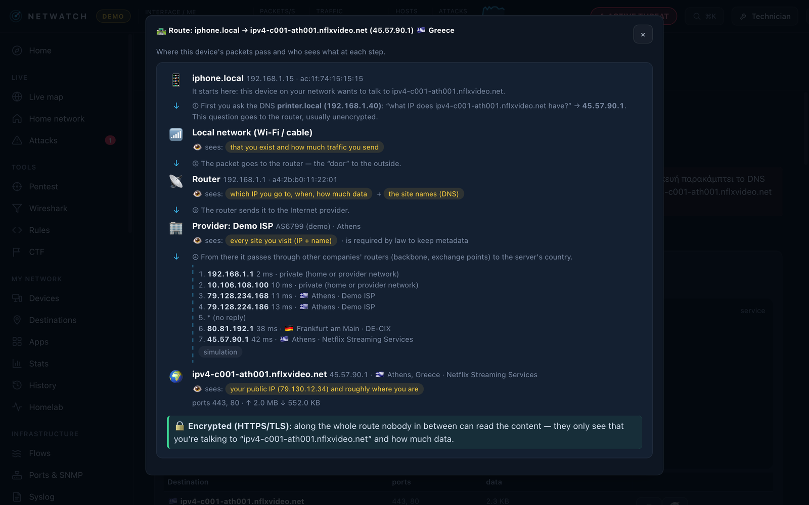 **Route**: hop by hop with traceroute, and who sees what |
| 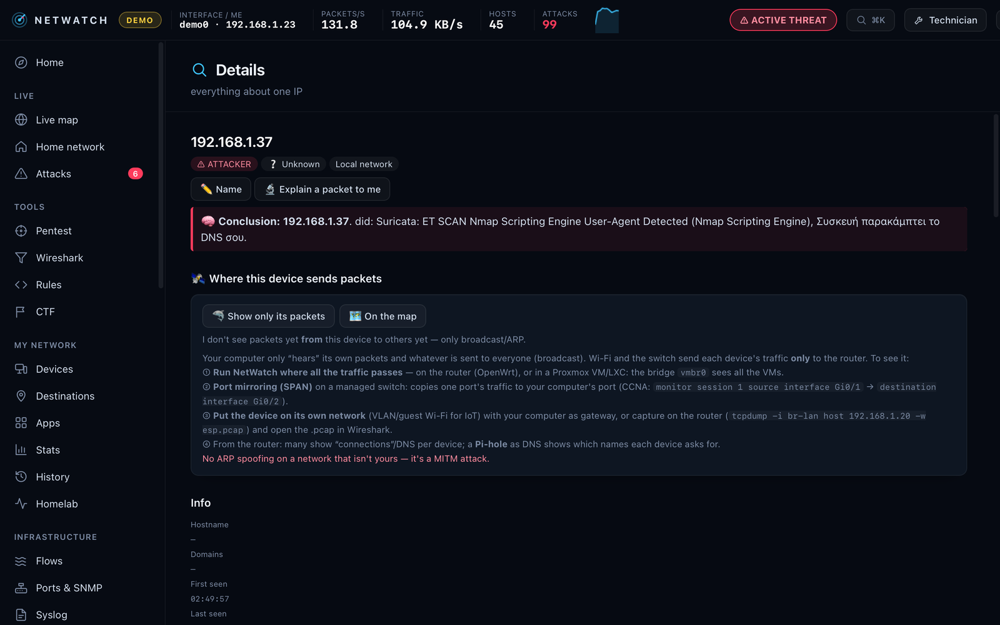 **Attacker analysis**: verdict, targeted services, OSINT |  **Statistics**: protocols, traffic, MITRE ATT&CK |
|  **Wireshark notes**: 167 filters and commands, many run live | 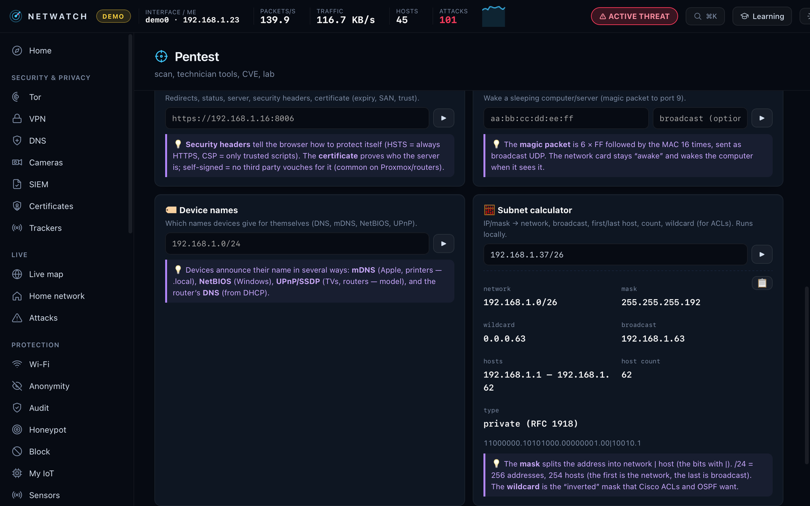 **Technician tools** with explanations in learning mode |
| 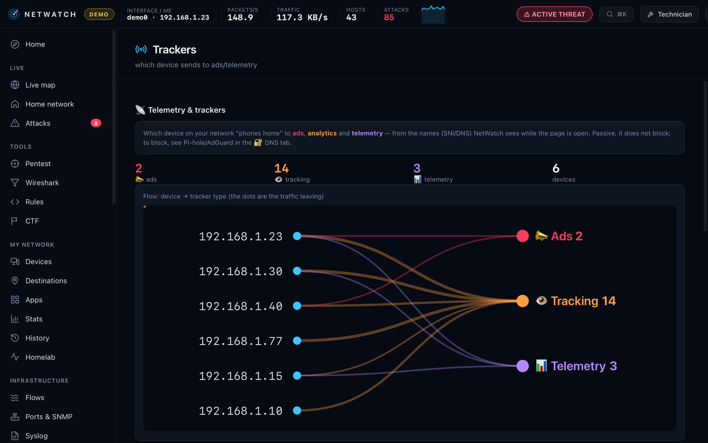 **Trackers**: which device talks to ads/analytics/telemetry, animated | 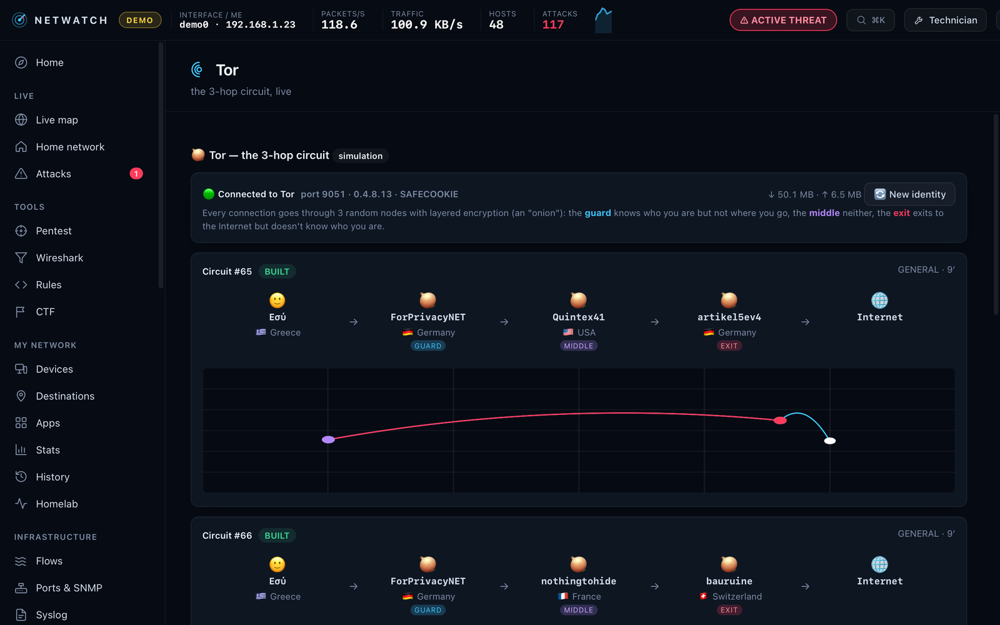 **Tor circuit**: the 3 hops with countries and a live map | 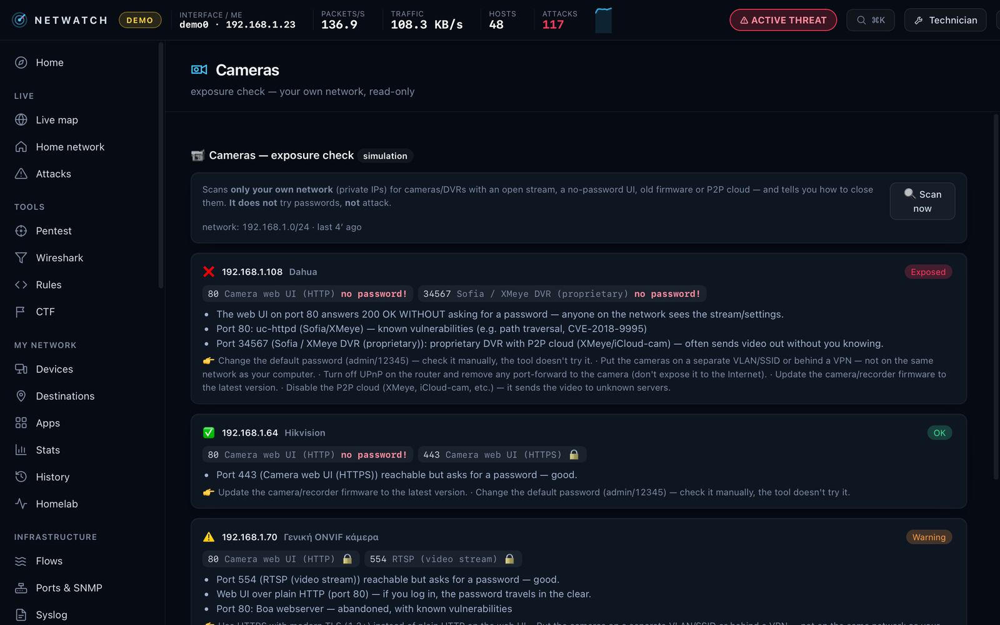 **Cameras**: exposure check on your own LAN, with fixes |
| 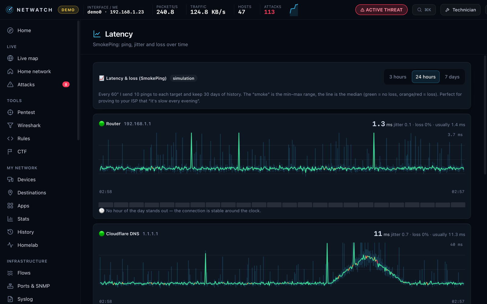 **Latency**: median, jitter and loss per target, worst hours | 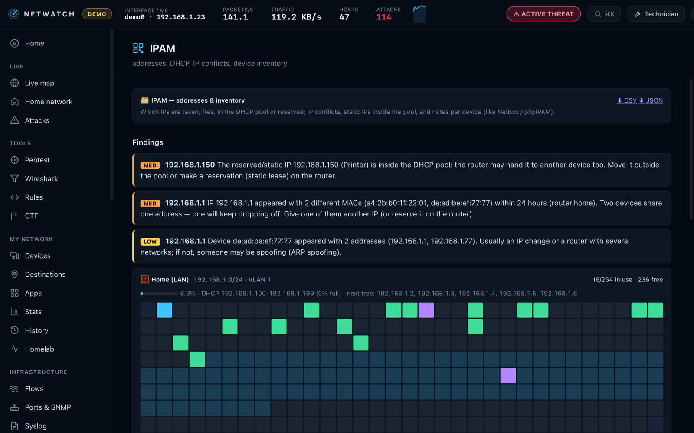 **IPAM**: every address, DHCP pool, conflicts, notes |
| 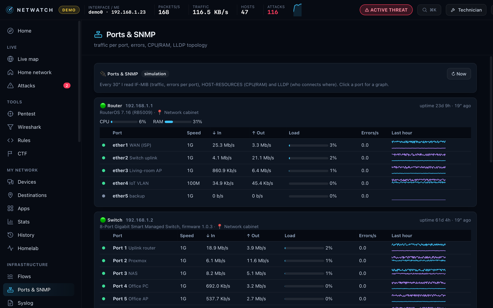 **SNMP**: interfaces and LLDP/CDP topology | 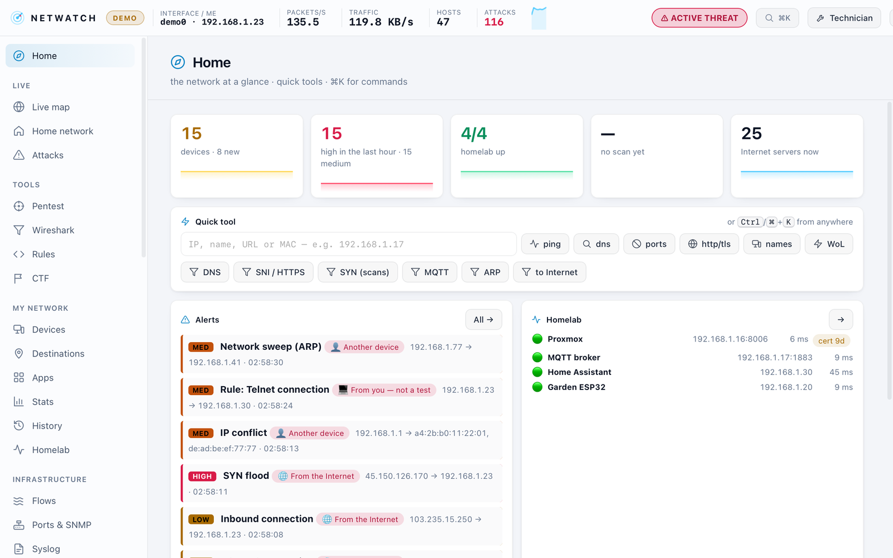 **Light theme** with accent colours and a colour-blind mode |
| 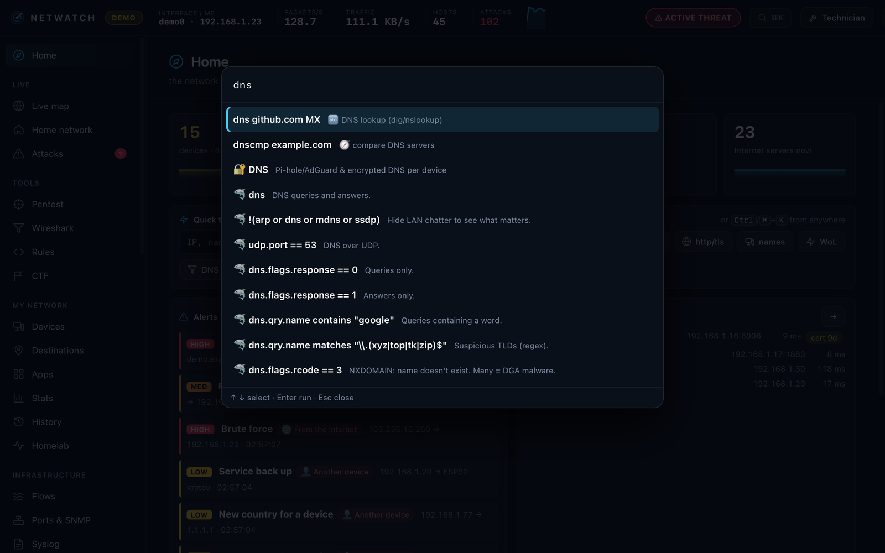 **⌘K palette**: `ping`, `dig`, `nc`, `nmap`, Wireshark filters |  **Academy**: CCNA and IoT security lessons with animations |

<sub>All screenshots come from demo mode (simulated traffic) and are regenerated with [`tools/shots/make_shots.sh`](tools/shots/make_shots.sh).</sub>

## Quick start

```bash
git clone <this repo> && cd netwatch
./run.sh --pcap samples/lan-attack.pcap   # replay a recorded attack (no root)
./run.sh --demo                           # simulated traffic and attacks
./run.sh                                  # live capture on your default interface (sudo)
```

The dashboard opens at <http://127.0.0.1:8765>. It is bound to localhost only.

| Option | |
|---|---|
| `-i en0` | interface to capture on |
| `-f "not port 22"` | BPF capture filter |
| `--pcap FILE --speed 10 --loop` | replay a capture 10× faster, in a loop (`--speed 0` = as fast as possible) |
| `--me IP --gw IP` | override the auto-detected host and router in a PCAP |
| `--no-geo` / `--no-rdns` | disable ip-api.com geolocation or reverse DNS |
| `--config FILE` | YAML config (defaults to `config.yaml`; see [`config.example.yaml`](config.example.yaml)) |
| `--history FILE` | SQLite history (live: `data/netwatch.db`; demo/pcap: in memory) |
| `--notify` / `--no-intel` | force notifications in demo/pcap, or skip downloading the blocklists |

```bash
cp config.example.yaml config.yaml   # tune thresholds, allowlist, AbuseIPDB key, Telegram bot
docker compose up -d                 # Linux: run as a service, history in ./data
```

### macOS app

```bash
./macapp/build.sh --install   # builds NetWatch.app into ~/Applications (needs only the Command Line Tools)
./macapp/build.sh --dmg       # also packs dist/NetWatch.dmg (drag-to-Applications installer)
```

A native menu-bar app written in Swift (AppKit + WKWebView), compiled with `swiftc`, so Xcode is not needed. The shield icon in the menu bar turns green, yellow or red and shows the alert count. Its menu shows the latest alert and the Wi‑Fi Guard verdict, and lets you run a Wi‑Fi check or switch between **Live**, **Demo** and **pcap replay**. The dashboard opens in its own window. Downloads (incident reports, map snapshots) are saved to `~/Downloads`, and external links open in your browser. Live capture asks for your administrator password in the standard macOS dialog. The Python backend runs from `~/Library/Application Support/NetWatch`, where its history and settings also live, and it exits when the app quits. The app is signed ad hoc, so the first time you open a copy built on another Mac, use right-click → Open.

## Architecture

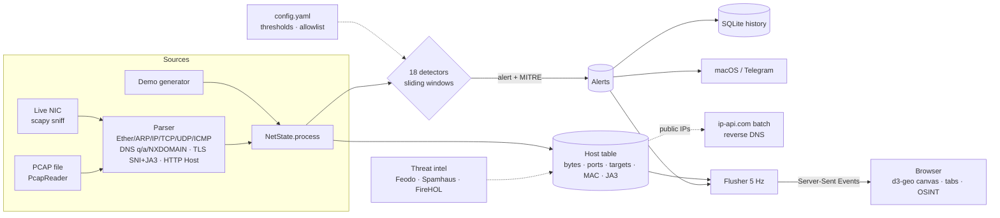

* **One engine, three inputs.** Live capture, PCAP replay and the demo all produce the same packet dicts, so the detectors and tests exercise exactly the code that runs in production.
* **Sliding-window detectors.** Each detector keeps a per-key `deque` of `(timestamp, item)` pairs, so they cost O(1) per packet and use bounded memory. Alerts have a 60 s cooldown per (type, actor).
* **Beaconing.** For each (local host, remote IP, port) NetWatch records TCP connection starts. An alert fires when the last N intervals have a coefficient of variation ≤ 15 %, which is the "heartbeat" of a C2 implant. Humans don't browse on a timer.
* **DNS tunneling and DGA.** DNS tunneling is flagged when one base domain gets many unique, high-entropy subdomains (Shannon entropy over a length threshold). DGA is flagged on bursts of NXDOMAIN answers for labels with a high "machine-made" score (entropy, vowel ratio, digit ratio, consonant runs). Typos and normal lookups stay quiet; the tests check this.
* **ARP trust model.** The first MAC seen for each IP (seeded from `arp -an`) is trusted. A spoof is attributed to the device that really owns the new MAC, and the router restoring its own MAC is not reported.
* **Back-pressure.** The UI gets at most about 800 packets/s, sampled, and attack packets are kept first.
* **No framework.** The backend uses only the Python standard library plus `scapy`, `pyyaml` for the config, and `paho-mqtt` for the optional ESP32 sensors. The frontend is one HTML file with d3 and topojson, plus plain-JS lesson files.

| Module | |
|---|---|
| `netwatch.py` | entry point: CLI, wiring, startup (re-exports everything for backwards compatibility) |
| `core.py` | constants, MITRE map, config, small helpers |
| `detect.py` | `NetState`: host table and all detectors |
| `capture.py` | packet parsing (TLS/JA3, cleartext logins), live capture, PCAP replay, CTF |
| `storage.py` | threat intel, SQLite history, notifications |
| `osint.py` · `demo.py` · `server.py` | geolocation/traceroute/whois · simulation · HTTP API + SSE |
| `wifiguard.py` · `privacy.py` · `apps.py` · `honeypot.py` · `blocker.py` · `iotcheck.py` · `sensor.py` · `mqttwatch.py` · `agent.py` · `packets.py` · `hass.py` · `baseline.py` · `report.py` · `playbooks.py` · `health.py` · `shellrun.py` | one feature each |
| `academy/` | lesson engine (`engine.js`) and content; checked by `tools/check_academy.js` |

## Detection matrix

| Alert | Trigger | MITRE ATT&CK |
|---|---|---|
| Port scan (TCP/UDP) | ≥ 20 distinct (target, port) probes from one source in 10 s | [T1046](https://attack.mitre.org/techniques/T1046/) Network Service Discovery |
| Stealth scan NULL/FIN/XMAS | TCP with flags no real stack sends | [T1046](https://attack.mitre.org/techniques/T1046/) |
| Network sweep (ping/ARP) | ≥ 30 / 40 distinct hosts probed in 10 s | [T1018](https://attack.mitre.org/techniques/T1018/) Remote System Discovery |
| Brute force | ≥ 15 connections to SSH/RDP/SMB/FTP/VNC/DB ports in 30 s | [T1110.001](https://attack.mitre.org/techniques/T1110/001/) Password Guessing |
| SYN / ICMP flood | ≥ 300 SYN or ≥ 100 echo requests in 5 s | [T1498.001](https://attack.mitre.org/techniques/T1498/001/) Direct Network Flood |
| ARP spoofing / ARP flood | trusted IP→MAC binding changes, or ≥ 60 replies in 5 s | [T1557.002](https://attack.mitre.org/techniques/T1557/002/) ARP Cache Poisoning |
| Rogue DHCP server | DHCP offer from a server other than the known one | [T1557.003](https://attack.mitre.org/techniques/T1557/003/) DHCP Spoofing |
| DNS spoofing | DNS answer from a server the host never queried | [T1557](https://attack.mitre.org/techniques/T1557/) Adversary-in-the-Middle |
| Inbound probe | unsolicited SYN from the Internet | [T1595](https://attack.mitre.org/techniques/T1595/) Active Scanning |
| Suspicious outbound port | connection to 4444, 6667, 31337… | [T1571](https://attack.mitre.org/techniques/T1571/) Non-Standard Port |
| Beaconing | ≥ 8 connections to the same host:port with interval jitter ≤ 15 % | [T1071](https://attack.mitre.org/techniques/T1071/) Application Layer Protocol (C2) |
| DNS tunneling | ≥ 30 unique high-entropy subdomains of one domain in 60 s | [T1071.004](https://attack.mitre.org/techniques/T1071/004/) DNS |
| DGA domains | ≥ 8 NXDOMAINs for machine-generated names in 60 s | [T1568.002](https://attack.mitre.org/techniques/T1568/002/) Domain Generation Algorithms |
| New device | a MAC never seen before (remembered across runs in SQLite) | [T1200](https://attack.mitre.org/techniques/T1200/) Hardware Additions |
| Threat-intel match | traffic to or from an IP on Feodo / Spamhaus / FireHOL | [T1071](https://attack.mitre.org/techniques/T1071/) C2 · [T1595](https://attack.mitre.org/techniques/T1595/) Active Scanning |
| Cleartext credentials | FTP/POP3 `USER`+`PASS`, IMAP `LOGIN`, SMTP `AUTH`, HTTP `Authorization: Basic`, login forms over HTTP, Telnet sessions | [T1040](https://attack.mitre.org/techniques/T1040/) Network Sniffing |

All thresholds can be changed in `config.yaml`.

## Testing

```bash
pip install -r requirements.txt -r requirements-dev.txt
python -m pytest -v
```

There are 181 tests. They cover every detector, including **negative cases**: normal browsing/DNS/QUIC raises nothing, irregular browsing is not beaconing, popular domains are not tunneling, typo domains are not DGA, known devices from history stay quiet, and ordinary HTTP requests are not mistaken for logins. The credential tests also assert that **the password never appears** in any parser result or alert. The pentest tests check that the scanner refuses public, oversized and invalid targets. They also check banner parsing, that every loud lab attack is detected and every stealthy one slips under its threshold, that lab alerts stay out of history and the audit, and that the POST endpoints reject cross-site requests. The rule tests check matching semantics, clear validation errors, distinct-value thresholds and the Sigma and Suricata output. The CTF tests check that answers are hashed, that the level pcaps rebuild byte-for-byte, that level 3 stays silent, and that the rule challenge rejects a naive rule with false positives. The Wi‑Fi Guard tests parse `system_profiler`, `lsof` and firewall output from fixtures, check the evil-twin, DNS-hijack and TLS verdicts, and confirm that trusted networks skip public-only warnings and that alerts are not repeated. Two more cover the macOS app's status endpoint and check that the backend exits when the app process dies. The new tests cover the shell allowlist (chaining, redirection, sudo, nmap outside private ranges and file-writing flags are all rejected), the MQTT anonymous-access probe against a fake broker, the sensor topic/payload handling (the sensor id comes from the topic, not the payload), honeypot hits, and pf rule generation. MQTT `CONNECT` parsing (3.1.1 and 5, with and without a will) must find the user but never keep the password. The MQTT guard tests cover the learning period, unknown clients, night commands, silence detection and persistence. The agent tests cover the token file permissions, cookie/bearer auth and the same-origin check, and ntfy publishing is tested against a fake server. Further tests check that packet decoding never exposes payload content and that the packet store evicts the oldest entries first. They also cover the Home Assistant discovery and the 10-minute attack window, the per-device country baseline (learning period, persistence, ignoring this computer), escaping in the weekly report, and canary events (the alert names the IP that touched the canary, and invalid IPs are rejected). The privacy tests grade leak scenarios (no VPN, leaking VPN, clean VPN, Tor, VPN that does not route), run the SOCKS5 client against a fake Tor proxy to check that the hostname is resolved inside the tunnel, and check that passive DNS/IPv6 leak alerts fire only when a VPN is up and capture is on the physical interface. They also check that your own Tor's relay connections are marked as expected, the traceroute parser, and that the traceroute endpoint refuses private, non-IP and injected targets. The suite also covers the threat-intel parser and lookup, config deep-merge and allowlist, JA3 stability, SQLite persistence, the scapy and TLS parsers, and an **end-to-end PCAP replay** of [`samples/lan-attack.pcap`](samples/lan-attack.pcap), which must raise all 14 expected alerts and attribute them to the right hosts. CI runs them on Python 3.9 and 3.12. It also checks every Academy lesson (ids, quiz answers, scene references, lab regexes against their answers) and compiles the ESP32 firmware. Pushing a `v*` tag builds `NetWatch.dmg` on macOS and attaches it to a GitHub Release.

The sample capture is generated reproducibly by [`tools/make_sample_pcap.py`](tools/make_sample_pcap.py). It plays a compromised laptop on the LAN that runs an ARP sweep, a SYN and XMAS scan, SSH brute force, ARP spoofing of the gateway, a rogue DHCP server, DNS spoofing, a SYN flood, DNS-tunnel exfiltration and DGA lookups. The user then logs into the router (HTTP Basic) and a media server (FTP) without encryption, and finally an unknown device joins the network. The CTF levels are generated the same way by [`tools/make_ctf.py`](tools/make_ctf.py). That file contains the answers, so it is a spoiler.

## Limitations

* On switched or Wi-Fi networks a host only sees **its own unicast traffic** plus broadcast and multicast. NetWatch therefore detects attacks *against* the sensor and LAN-wide attacks (ARP/DHCP/sweeps), but not attacks between two other devices. Run it on a SPAN/mirror port to monitor a whole network.
* Behind NAT, most Internet-borne scans are dropped by the router before they reach the sensor.
* The thresholds are heuristics and some legitimate tools trigger them (e.g. Fing sweeps the LAN). DHCP lease changes can cause an ARP false positive.
* Geolocation reflects the server or VPN exit, not necessarily the person behind it.
* Beaconing can flag legitimate pollers (updaters, messengers) and general blocklists contain some false positives. Add those to the allowlist.
* The Docker image needs Linux host networking; on macOS run NetWatch natively.

## Ethics

Only monitor and scan networks you own or are authorised to test. The monitor is passive and never sends packets to the hosts it observes. Only the 🔴 Pentest tab is active, and only when you press *Scan*. It refuses anything outside private address ranges. The purple-team lab never touches the network: its attack packets are injected straight into the detection engine. The state-changing endpoints (`POST /api/scan`, `/api/lab`, `/api/exposure`) only accept JSON from the NetWatch page itself, which protects them against CSRF and DNS rebinding. Geolocation sends public destination IPs, never packet contents, to ip-api.com; turn this off with `--no-geo`. Blocklists are downloaded and no data about your traffic is sent. AbuseIPDB and Telegram are only contacted if you configure them. The exposure check sends your public IP to internetdb.shodan.io, and the CVE button sends a product name and version to the NVD. Both happen only when you click.

## License

[MIT](LICENSE)
