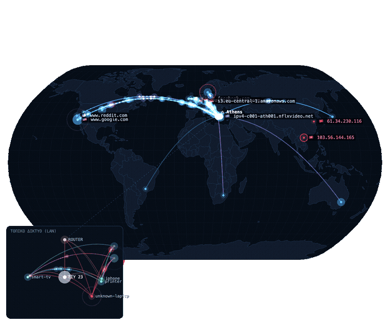
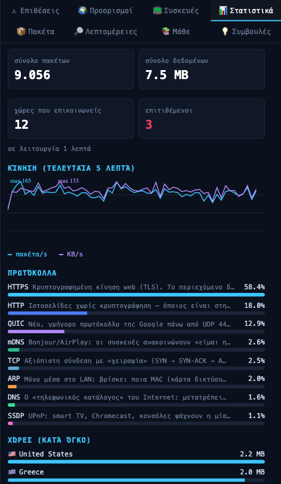
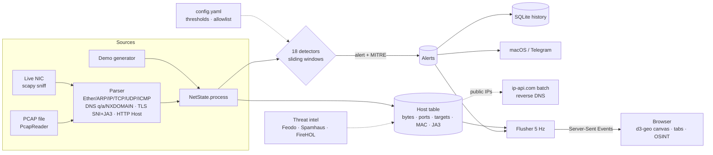

# ◉ NetWatch

**A live network-traffic map and intrusion-detection sensor in a single Python file.** Every packet on your network becomes an animated arc on a world map. NetWatch watches for scans, brute force, man-in-the-middle attacks, DoS, **C2 beaconing, DNS tunneling, DGA malware** and **known-bad IPs from threat-intel feeds**. It maps each alert to **MITRE ATT&CK**, keeps a SQLite history, can notify you on macOS or Telegram, and gives you OSINT on every IP it sees.



[](../../actions/workflows/ci.yml)


> 🇬🇷 Ελληνική τεκμηρίωση: [README.el.md](README.el.md). The UI is in Greek.

---

## Features

| | |
|---|---|
| 🗺 **Live world map** | Packets fly between your home and each server, coloured by protocol (HTTPS, QUIC, DNS, ICMP, ARP…). Zoom and pan go down to city level, with country labels. |
| 🏠 **LAN view** | Shows you, the router and every device on the local network. MITM attacks and sweeps show up here. |
| 🚨 **18 detectors** | Port/UDP scans, NULL/FIN/XMAS stealth scans, brute force, SYN/ICMP flood, ping and ARP sweeps, ARP spoofing, ARP flood, rogue DHCP, DNS spoofing, inbound probes, C2-style ports, **C2 beaconing**, **DNS tunneling**, **DGA domains**, **new devices**, **threat-intel matches**, **passwords sent in cleartext**. |
| ⛔ **Threat intelligence** | Downloads Feodo Tracker (botnet C2), Spamhaus DROP and FireHOL level1 once a day, giving about 4,500 CIDRs with prefix-bucketed O(1) lookups. One click checks an IP's AbuseIPDB score (with your own API key). |
| 🔏 **JA3 fingerprints** | Fingerprints the client application of every TLS ClientHello (with GREASE removed), even though the traffic is encrypted. |
| 🛡 **Security audit** | A passive home-network check graded A–F. It lists cleartext logins (FTP, Telnet, POP3, IMAP, SMTP, HTTP Basic and form posts), risky services listening on the LAN (Telnet, RDP, VNC, SMB, UPnP, open databases…), recent attacks, unknown devices and unencrypted HTTP/DNS, each with a fix. Usernames are masked and **passwords are never stored or shown**. |
| 🎓 **Learning mode** | Click any packet to see it split into OSI layers (L1–L7), each with a plain-language explanation. A quiz tab asks about attacks, ports, TCP flags, MITRE tactics and defence steps, and also builds questions from **the alerts your own network just raised**. |
| 🔴 **Pentest toolkit** | An **active LAN scanner** (ARP discovery, TCP connect scan of 44 common ports, banner grabbing with version detection, TLS checks for old protocols, expired and self-signed certificates). Each detected version has a one-click **CVE lookup** in NVD. An **external-exposure check** shows what Shodan InternetDB sees on your public IP. A **purple-team lab** runs loud and stealthy versions of 7 attacks through the detection engine and explains why each one was caught or missed. The scanner only accepts private ranges (at most 1,024 hosts). |
| 🧩 **Custom detection rules** | Write rules in YAML: IPs/CIDRs and keywords like `me`, `local` or `public` with `!` negation, port ranges, TCP flags, DNS/SNI/HTTP-host globs, and thresholds with `distinct` counting. **Test a rule against the last 5,000 packets** before saving it. Every rule exports to **Sigma** (for SIEMs) and **Suricata** (for IDS). It ships with 5 starter rules in [`rules/`](rules/default.yaml). |
| 🚩 **CTF** | Three traffic-analysis challenges built on pcaps. Loading a level swaps the live view for that capture: *LAN intruder* (easy), *the silent visitor* (DGA plus C2 beaconing from an infected TV, medium) and *the patient one* (a slow scan that slips under every built-in detector, hard). The hard level ends with **writing a rule that catches the attacker with zero false positives**, checked by replaying the pcap through your rule. Answers are stored only as SHA-256 hashes. |
| 🕓 **History** | SQLite stores alerts, traffic per minute and every device ever seen. A history tab shows alerts per hour, a searchable alert archive and a device inventory. |
| 🔔 **Notifications** | macOS Notification Center (also under `sudo`) and Telegram bot, with a severity floor and cooldown. |
| ⚙ **YAML config** | Every threshold, per-detector on/off switches, and an allowlist of IPs, MACs and domains. |
| 🐳 **Docker** | `docker compose up` on any Linux host (host networking with `NET_RAW`). |
| 🎯 **MITRE ATT&CK** | Every alert carries its technique ID and tactic, and a coverage grid shows which tactics were observed. |
| 🔎 **Attacker analysis** | Lists the ports and services an attacker targeted, *why* those matter, who the victims were, an activity timeline and a plain-language verdict. |
| 🌍 **OSINT** | Shows geolocation, ISP, ASN and proxy/VPN/hosting flags for each IP, plus reverse DNS and domains learned from DNS answers and TLS SNI. WHOIS runs in one click, and there are links to AbuseIPDB, Shodan, VirusTotal, GreyNoise, Censys and OTX. |
| ▶ **PCAP replay** | Feeds any `.pcap`/`.pcapng` through the same engine at real time or faster. Needs no root. |
| 📄 **Incident report** | Exports alerts and attacker profiles as JSON with one click, and the map as a PNG. |
| 📚 **Built-in training** | Each alert explains *what it is, how it works, the risk and what to do*. Clicking a packet explains it in plain words. There are also a protocol/port glossary and context-aware security tips. |

<p>
  
</p>
<p>
  
  
</p>

## Quick start

```bash
git clone <this repo> && cd netwatch
./run.sh --pcap samples/lan-attack.pcap   # replay a recorded attack (no root)
./run.sh --demo                           # simulated traffic and attacks
./run.sh                                  # live capture on your default interface (sudo)
```

The dashboard opens at <http://127.0.0.1:8765>. It is bound to localhost only.

| Option | |
|---|---|
| `-i en0` | interface to capture on |
| `-f "not port 22"` | BPF capture filter |
| `--pcap FILE --speed 10 --loop` | replay a capture 10× faster, in a loop (`--speed 0` = as fast as possible) |
| `--me IP --gw IP` | override the auto-detected host and router in a PCAP |
| `--no-geo` / `--no-rdns` | disable ip-api.com geolocation or reverse DNS |
| `--config FILE` | YAML config (defaults to `config.yaml`; see [`config.example.yaml`](config.example.yaml)) |
| `--history FILE` | SQLite history (live: `data/netwatch.db`; demo/pcap: in memory) |
| `--notify` / `--no-intel` | force notifications in demo/pcap, or skip downloading the blocklists |

```bash
cp config.example.yaml config.yaml   # tune thresholds, allowlist, AbuseIPDB key, Telegram bot
docker compose up -d                 # Linux: run as a service, history in ./data
```

## Architecture



* **One engine, three inputs.** Live capture, PCAP replay and the demo all produce the same packet dicts, so the detectors and tests exercise exactly the code that runs in production.
* **Sliding-window detectors.** Each detector keeps a per-key `deque` of `(timestamp, item)` pairs, so they cost O(1) per packet and use bounded memory. Alerts have a 60 s cooldown per (type, actor).
* **Beaconing.** For each (local host, remote IP, port) NetWatch records TCP connection starts. An alert fires when the last N intervals have a coefficient of variation ≤ 15 %, which is the "heartbeat" of a C2 implant. Humans don't browse on a timer.
* **DNS tunneling and DGA.** DNS tunneling is flagged when one base domain gets many unique, high-entropy subdomains (Shannon entropy over a length threshold). DGA is flagged on bursts of NXDOMAIN answers for labels with a high "machine-made" score (entropy, vowel ratio, digit ratio, consonant runs). Typos and normal lookups stay quiet; the tests check this.
* **ARP trust model.** The first MAC seen for each IP (seeded from `arp -an`) is trusted. A spoof is attributed to the device that really owns the new MAC, and the router restoring its own MAC is not reported.
* **Back-pressure.** The UI gets at most about 800 packets/s, sampled, and attack packets are kept first.
* **No framework.** The backend uses only the Python standard library plus `scapy` (and `pyyaml` for the config). The frontend is one HTML file with d3 and topojson.

## Detection matrix

| Alert | Trigger | MITRE ATT&CK |
|---|---|---|
| Port scan (TCP/UDP) | ≥ 20 distinct (target, port) probes from one source in 10 s | [T1046](https://attack.mitre.org/techniques/T1046/) Network Service Discovery |
| Stealth scan NULL/FIN/XMAS | TCP with flags no real stack sends | [T1046](https://attack.mitre.org/techniques/T1046/) |
| Network sweep (ping/ARP) | ≥ 30 / 40 distinct hosts probed in 10 s | [T1018](https://attack.mitre.org/techniques/T1018/) Remote System Discovery |
| Brute force | ≥ 15 connections to SSH/RDP/SMB/FTP/VNC/DB ports in 30 s | [T1110.001](https://attack.mitre.org/techniques/T1110/001/) Password Guessing |
| SYN / ICMP flood | ≥ 300 SYN or ≥ 100 echo requests in 5 s | [T1498.001](https://attack.mitre.org/techniques/T1498/001/) Direct Network Flood |
| ARP spoofing / ARP flood | trusted IP→MAC binding changes, or ≥ 60 replies in 5 s | [T1557.002](https://attack.mitre.org/techniques/T1557/002/) ARP Cache Poisoning |
| Rogue DHCP server | DHCP offer from a server other than the known one | [T1557.003](https://attack.mitre.org/techniques/T1557/003/) DHCP Spoofing |
| DNS spoofing | DNS answer from a server the host never queried | [T1557](https://attack.mitre.org/techniques/T1557/) Adversary-in-the-Middle |
| Inbound probe | unsolicited SYN from the Internet | [T1595](https://attack.mitre.org/techniques/T1595/) Active Scanning |
| Suspicious outbound port | connection to 4444, 6667, 31337… | [T1571](https://attack.mitre.org/techniques/T1571/) Non-Standard Port |
| Beaconing | ≥ 8 connections to the same host:port with interval jitter ≤ 15 % | [T1071](https://attack.mitre.org/techniques/T1071/) Application Layer Protocol (C2) |
| DNS tunneling | ≥ 30 unique high-entropy subdomains of one domain in 60 s | [T1071.004](https://attack.mitre.org/techniques/T1071/004/) DNS |
| DGA domains | ≥ 8 NXDOMAINs for machine-generated names in 60 s | [T1568.002](https://attack.mitre.org/techniques/T1568/002/) Domain Generation Algorithms |
| New device | a MAC never seen before (remembered across runs in SQLite) | [T1200](https://attack.mitre.org/techniques/T1200/) Hardware Additions |
| Threat-intel match | traffic to or from an IP on Feodo / Spamhaus / FireHOL | [T1071](https://attack.mitre.org/techniques/T1071/) C2 · [T1595](https://attack.mitre.org/techniques/T1595/) Active Scanning |
| Cleartext credentials | FTP/POP3 `USER`+`PASS`, IMAP `LOGIN`, SMTP `AUTH`, HTTP `Authorization: Basic`, login forms over HTTP, Telnet sessions | [T1040](https://attack.mitre.org/techniques/T1040/) Network Sniffing |

All thresholds can be changed in `config.yaml`.

## Testing

```bash
pip install -r requirements.txt -r requirements-dev.txt
python -m pytest -v
```

There are 99 tests. They cover every detector, including **negative cases**: normal browsing/DNS/QUIC raises nothing, irregular browsing is not beaconing, popular domains are not tunneling, typo domains are not DGA, known devices from history stay quiet, and ordinary HTTP requests are not mistaken for logins. The credential tests also assert that **the password never appears** in any parser result or alert. The pentest tests check that the scanner refuses public, oversized and invalid targets. They also check banner parsing, that every loud lab attack is detected and every stealthy one slips under its threshold, that lab alerts stay out of history and the audit, and that the POST endpoints reject cross-site requests. The rule tests check matching semantics, clear validation errors, distinct-value thresholds and the Sigma and Suricata output. The CTF tests check that answers are hashed, that the level pcaps rebuild byte-for-byte, that level 3 stays silent, and that the rule challenge rejects a naive rule with false positives. The suite also covers the threat-intel parser and lookup, config deep-merge and allowlist, JA3 stability, SQLite persistence, the scapy and TLS parsers, and an **end-to-end PCAP replay** of [`samples/lan-attack.pcap`](samples/lan-attack.pcap), which must raise all 14 expected alerts and attribute them to the right hosts. CI runs them on Python 3.9 and 3.12.

The sample capture is generated reproducibly by [`tools/make_sample_pcap.py`](tools/make_sample_pcap.py). It plays a compromised laptop on the LAN that runs an ARP sweep, a SYN and XMAS scan, SSH brute force, ARP spoofing of the gateway, a rogue DHCP server, DNS spoofing, a SYN flood, DNS-tunnel exfiltration and DGA lookups. The user then logs into the router (HTTP Basic) and a media server (FTP) without encryption, and finally an unknown device joins the network. The CTF levels are generated the same way by [`tools/make_ctf.py`](tools/make_ctf.py). That file contains the answers, so it is a spoiler.

## Limitations

* On switched or Wi-Fi networks a host only sees **its own unicast traffic** plus broadcast and multicast. NetWatch therefore detects attacks *against* the sensor and LAN-wide attacks (ARP/DHCP/sweeps), but not attacks between two other devices. Run it on a SPAN/mirror port to monitor a whole network.
* Behind NAT, most Internet-borne scans are dropped by the router before they reach the sensor.
* The thresholds are heuristics and some legitimate tools trigger them (e.g. Fing sweeps the LAN). DHCP lease changes can cause an ARP false positive.
* Geolocation reflects the server or VPN exit, not necessarily the person behind it.
* Beaconing can flag legitimate pollers (updaters, messengers) and general blocklists contain some false positives. Add those to the allowlist.
* The Docker image needs Linux host networking; on macOS run NetWatch natively.

## Ethics

Only monitor and scan networks you own or are authorised to test. The monitor is passive and never sends packets to the hosts it observes. Only the 🔴 Pentest tab is active, and only when you press *Scan*. It refuses anything outside private address ranges. The purple-team lab never touches the network: its attack packets are injected straight into the detection engine. The state-changing endpoints (`POST /api/scan`, `/api/lab`, `/api/exposure`) only accept JSON from the NetWatch page itself, which protects them against CSRF and DNS rebinding. Geolocation sends public destination IPs, never packet contents, to ip-api.com; turn this off with `--no-geo`. Blocklists are downloaded and no data about your traffic is sent. AbuseIPDB and Telegram are only contacted if you configure them. The exposure check sends your public IP to internetdb.shodan.io, and the CVE button sends a product name and version to the NVD. Both happen only when you click.

## License

[MIT](LICENSE)
